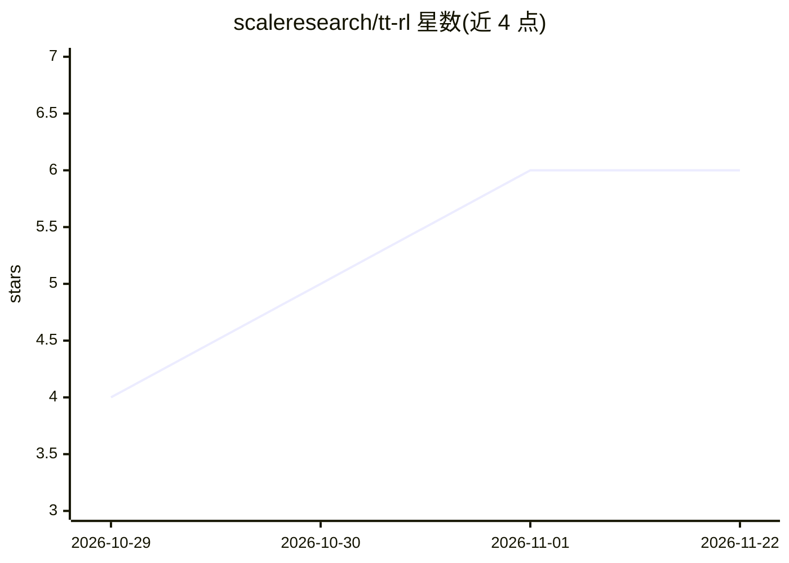

# scaleresearch/tt-rl

⭐ 6 · Python · MIT · 推送 2026-11-06 · [GitHub](https://github.com/scaleresearch/tt-rl) · [官网](https://huggingface.co/scaleresearch) · 组织维护

**在 Tenstorrent 芯片上原生训练 DQN/PPO/SAC 的强化学习库**

直接构建在 TT-NN 之上的强化学习库：网络、梯度、Adam 步骤与设备 trace 均在 Tenstorrent 芯片上运行，环境与 replay buffer 保留在主机端。实现 DQN（double、n-step、优先回放）、PPO（GAE、clipping、可选 GRU）与 SAC（双 critic、可学习温度），支持 Atari 像素与 MuJoCo 状态向量环境，单芯片或多芯片数据并行（每芯片一个副本，定期平均参数）。训练好的策略可导出为 numpy 或 ONNX 在任意 CPU 上运行。需要 Linux、Python 3.12 与一块 Tenstorrent Blackhole 芯片。

## 筛选速览

| 维度 | 判定 | 备注 |
|---|---|---|
| AI 角色 | `ai-native` | 本体是模型或模型工具 |
| 许可风险 | `permissive` | MIT |
| 部署形态 | `library` | 以包/库形式分发 |
| 模型依赖 | — | README 未给出锁定关系 |
| 硬件要求 | — | 无带数字的原话,不猜 |
| 安装摩擦 | `low` | 无编译、无系统依赖或容器化 |
| 成熟度 | — | 结构信号不足 |

## 能力要点

- 网络、梯度与 Adam 步骤通过 ttnn 在芯片上原生执行
- DQN、PPO、SAC 三类算法，含 double/n-step/优先回放等变体
- 多芯片数据并行：每芯片一个副本，定期同步平均参数
- 策略可导出 ONNX/numpy，用 onnxruntime 在 CPU 上部署

## 适用场景

- 在 Tenstorrent Blackhole 硬件上训练 Atari 与 MuJoCo 任务
- 按小型环境协议编写自定义环境接入训练流程
- 将训练好的策略导出后在无芯片的 CPU 机器上推理

## 场景标签

`强化学习` · 领域:训练与推理

## 证据(README 行号)

> L6: Reinforcement learning on Tenstorrent hardware, built directly on
> L16: - **Algorithms:** DQN (double, n-step, prioritized replay), PPO (GAE, clipping,
> L62: - A Tenstorrent Blackhole chip with its driver and firmware installed.

## 星数曲线

2026-10-29 4 → 2026-11-22 6（+2）

---
*卡片 v1 · prompt 1.4 · 生成 2026-11-20 · 置信度 high · 依据 README sha `20e78735ae7b` · [字段定义](../../DATASET.md)*
