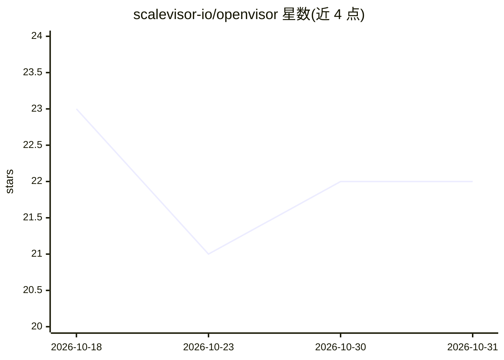

# scalevisor-io/openvisor

⭐ 22 · Python · Apache-2.0 · 推送 2026-10-02 · [GitHub](https://github.com/scalevisor-io/openvisor) · [官网](https://berwick.ai) · 组织维护

**自托管的 AI 软件咨询代理平台，24/7 接单、开发与交付**

面向想经营 AI 软件咨询业务的用户：Openvisor 提供白标客户门户、评估与定价审核、一次性容器沙箱中由编码代理（OpenHands SDK）构建、PR 审查门、自动部署的演示站以及 Stripe 预付积分计费。代理不能定价、批准或推进项目，由人担任顾问角色。支持任意 OpenAI 兼容端点、MCP 客户端接入、知识库与 MCP 工具；部署方式为 docker compose 或 Kubernetes Helm，自述为 Alpha 阶段。

## 筛选速览

| 维度 | 判定 | 备注 |
|---|---|---|
| AI 角色 | `ai-native` | 本体是模型或模型工具 |
| 许可风险 | `permissive` | Apache-2.0 |
| 部署形态 | `self-host` | docker 或自建部署 |
| 模型依赖 | local-ok | 支持本地模型 |
| 硬件要求 | — | 无带数字的原话,不猜 |
| 安装摩擦 | `low` | 无编译、无系统依赖或容器化 |
| 成熟度 | `idea` | |

## 能力要点

- 8 步咨询流程：接单→评估→定价→计划→沙箱构建→PR 发布→演示→交付，人工审核定价与批准
- 每客户项目暴露 MCP 端点，Claude Code、Cursor 等 MCP 客户端可查询代码库并委派任务
- 任意 OpenAI 兼容模型（OpenAI/Anthropic/Mistral/OpenRouter/自建 vLLM），按项目选择
- Stripe 预付积分计费、泄漏扫描、加密 secrets 与守护栏（禁止动作下限、限流、审计日志）

## 适用场景

- 独立开发者或小团队白标运营 AI 软件咨询业务
- 让客户的编码代理通过 MCP 访问项目代码库并委派工作
- 在自有 Kubernetes/compose 环境中托管代理构建沙箱与演示站

## 场景标签

`编码 Agent` · 领域:编码与开发

## 证据(README 行号)

> L3: **Your AI-native consulting agency, running 24/7 for you.**
> L45: Coding agents write code. Openvisor is the consultancy around them: the customer portal, the review gate, the sandb
> L69: |🧠 **Any model**|OpenAI-compatible endpoints, chosen per project, with a one-token probe for chat, reasoning effort

## 星数曲线

2026-10-18 23 → 2026-10-31 22（-1）

---
*卡片 v1 · prompt 1.4 · 生成 2026-10-28 · 置信度 high · 依据 README sha `f6875314a210` · [字段定义](../../DATASET.md)*
