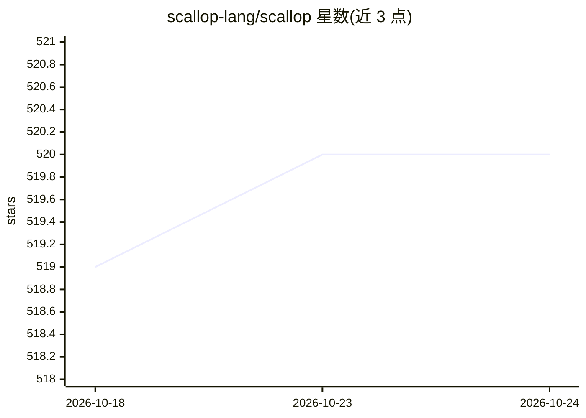

# scallop-lang/scallop

⭐ 520 · Rust · MIT · 推送 2026-06-26 · [GitHub](https://github.com/scallop-lang/scallop) · [官网](https://www.scallop-lang.org) · 组织维护

**面向神经符号编程的 DataLog 语言与框架，支持可微推理**

基于 DataLog 的语言与配套框架，构建于广义 Provenance Semiring 之上，可配置任意半环，从而执行离散逻辑推理、概率推理与可微推理。程序可通过 scallopy Python 绑定使用，并能与 PyTorch 学习模块集成（如 MNIST 求和任务），也可单独作为 DataLog 求解器。提供解释器 scli、编译器 sclc 与 REPL 三个二进制，从 Rust nightly 源码构建；语言特性含概率事实/规则、分层否定、聚合（count/min/max/sum/prod）、静态类型推断与 CSV 输入加载。

## 筛选速览

| 维度 | 判定 | 备注 |
|---|---|---|
| AI 角色 | `ai-ecosystem` | LLM/agent 周边工具 |
| 许可风险 | `permissive` | MIT |
| 部署形态 | `library` | 以包/库形式分发 |
| 模型依赖 | — | README 未给出锁定关系 |
| 硬件要求 | — | 无带数字的原话,不猜 |
| 安装摩擦 | `medium` | 含编译或系统依赖之一 |
| 成熟度 | — | 结构信号不足 |

## 能力要点

- 广义 Provenance Semiring 框架，支持离散/概率/可微三种推理
- scallopy Python 绑定可与 PyTorch 模块无缝集成
- 提供 scli 解释器、sclc 编译器与 sclrepl 交互式 REPL
- 语言支持概率事实与规则、分层否定、聚合与 argmax/argmin、类型推断及 CSV 输入

## 适用场景

- 在 PyTorch 训练管线中嵌入可微逻辑/关系推理层
- 编写概率 DataLog 程序做概率推理查询
- 作为通用 DataLog 求解器做符号推理实验

## 场景标签

 · 领域:神经符号计算/编程语言

## 证据(README 行号)

> L6: Scallop is a language based on DataLog that supports differentiable logical and relational reasoning.
> L7: Scallop program can be easily integrated in Python and even with a PyTorch learning module. You can also use it as a
> L107: In addition, `scallopy` can be seamlessly integrated with PyTorch.

## 星数曲线

2026-10-18 519 → 2026-10-24 520（+1）

---
*卡片 v1 · prompt 1.4 · 生成 2026-10-21 · 置信度 mid · 依据 README sha `aec6aceadd49` · [字段定义](../../DATASET.md)*
