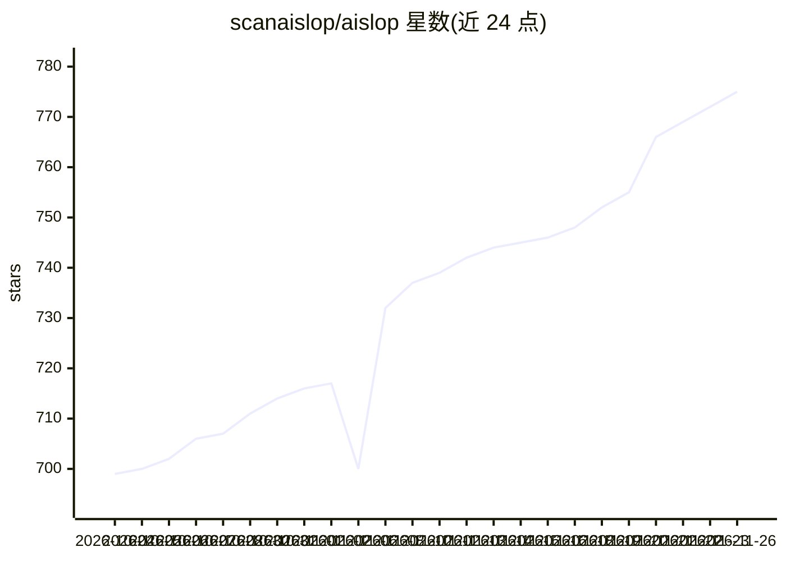

# scanaislop/aislop

⭐ 775 · TypeScript · MIT · 推送 2026-11-24 · [GitHub](https://github.com/scanaislop/aislop) · [官网](https://scanaislop.com) · 组织维护

**给开发者检测 AI 代码残留问题的本地代码质量扫描器**

面向 AI 辅助开发产出的代码，通过 50+ 条确定性规则检测叙事性注释、被吞异常、隐藏回退、`as any` 断言、幻觉导入、重复辅助函数、死代码、todo 存根与超大函数，覆盖 12 种语言目标并输出 0–100 分。运行路径不调用 LLM，同输入同输出，亚秒级完成；可本地运行或接入 CI 门禁，支持自动修复、按行内注释抑制单条发现、per-file 规则级别覆盖，并可与已安装的编码代理协作完成修复会话。

## 筛选速览

| 维度 | 判定 | 备注 |
|---|---|---|
| AI 角色 | `ai-enhanced` | 去掉 AI 部分产品仍成立 |
| 许可风险 | `permissive` | MIT |
| 部署形态 | `library` | 以包/库形式分发 |
| 模型依赖 | — | README 未给出锁定关系 |
| 硬件要求 | — | 无带数字的原话,不猜 |
| 安装摩擦 | `medium` | 含编译或系统依赖之一 |
| 成熟度 | — | 结构信号不足 |

## 能力要点

- 50+ 条确定性规则覆盖 12 种语言，运行时不调用 LLM
- 提供 hook、CI 门禁、自动修复与编码代理修复会话（本地 git worktree）
- 支持行内抑制指令、.aislopignore 路径忽略与父级配置 extends
- README 公共徽章与公开仓库报告页

## 适用场景

- 把 aislop ci 接进 CI 对每次变更做分数门禁
- 装 hook 让编码代理在每次编辑后修复 slop 问题
- 扫描仓库生成 README 上的公开分数徽章

## 场景标签

 · 领域:开发者工具/代码质量

## 证据(README 行号)

> L9: aislop catches them. 50+ rules across 12 language targets (TypeScript, JavaScript, Expo / React Native, Python, Go, 
> L7: The patterns Claude Code, Cursor, Codex, and OpenCode leave behind: narrative comments above self-explanatory code, 

## 星数曲线

2026-10-24 699 → 2026-11-26 775（+76）

---
*卡片 v1 · prompt 1.4 · 生成 2026-11-25 · 置信度 high · 依据 README sha `44532a0c79b0` · [字段定义](../../DATASET.md)*
