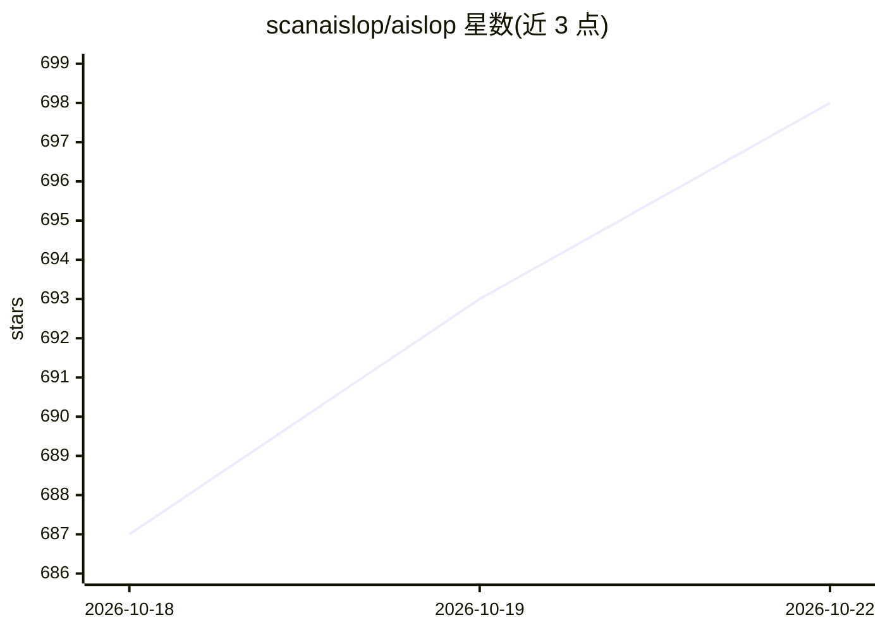

# scanaislop/aislop

⭐ 699 · TypeScript · MIT · 推送 2026-10-21 · [GitHub](https://github.com/scanaislop/aislop) · [官网](https://scanaislop.com) · 组织维护

**检测并修复 AI 编码代理遗留代码质量问题的 CLI 代码扫描器**

面向使用 AI 编码代理的开发者的确定性静态扫描工具：以 50+ 条规则覆盖 TypeScript、JavaScript、Python、Go、Rust、C/C++ 等 10 种语言目标，检测叙述性注释、吞异常、as any 强转、死代码、幻觉导入等 AI 常见问题，对每次变更输出 0-100 分。运行路径不含 LLM，同样输入产生同样分数。提供 fix 自动修复、agent 命令调用已安装的编码代理在 git worktree 中修复、编辑后 hook、MCP 服务器与 CI/SARIF 集成。安装途径含 npm、Homebrew、pipx。

## 筛选速览

| 维度 | 判定 | 备注 |
|---|---|---|
| AI 角色 | `ai-ecosystem` | LLM/agent 周边工具 |
| 许可风险 | `permissive` | MIT |
| 部署形态 | `library` | 以包/库形式分发 |
| 模型依赖 | — | README 未给出锁定关系 |
| 硬件要求 | — | 无带数字的原话,不猜 |
| 安装摩擦 | `medium` | 含编译或系统依赖之一 |
| 成熟度 | — | 结构信号不足 |

## 能力要点

- 50+ 确定性规则覆盖 10 种语言目标，运行时无 LLM
- 0-100 评分与 CI 门禁（--changes/--base 可只检查 PR 触及文件）
- aislop agent 在本地 git worktree 中调用 Codex/Claude Code/OpenCode 修复并用扫描验证
- aislop fix --safe 仅执行不改变行为的修复
- 编辑后 hook 与 MCP 服务器（aislop_scan/aislop_fix 等工具）

## 适用场景

- AI 编码代理生成的代码合入前扫描评分
- 在 CI 中对 PR 变更文件设质量门禁
- 通过 hook 让代理每次编辑后即时收到反馈
- 把扫描结果交回编码代理自动修复

## 场景标签

 · 领域:开发工具/代码质量

## 证据(README 行号)

> L7: The patterns Claude Code, Cursor, Codex, and OpenCode leave behind: narrative comments above self-explanatory code, 
> L9: aislop catches them. 50+ rules across 10 language targets (TypeScript, JavaScript, Expo / React Native, Python, Go, 

## 星数曲线

2026-10-18 687 → 2026-10-22 698（+11）

---
*卡片 v1 · prompt 1.4 · 生成 2026-10-21 · 置信度 high · 依据 README sha `fb593dc21b5d` · [字段定义](../../DATASET.md)*
