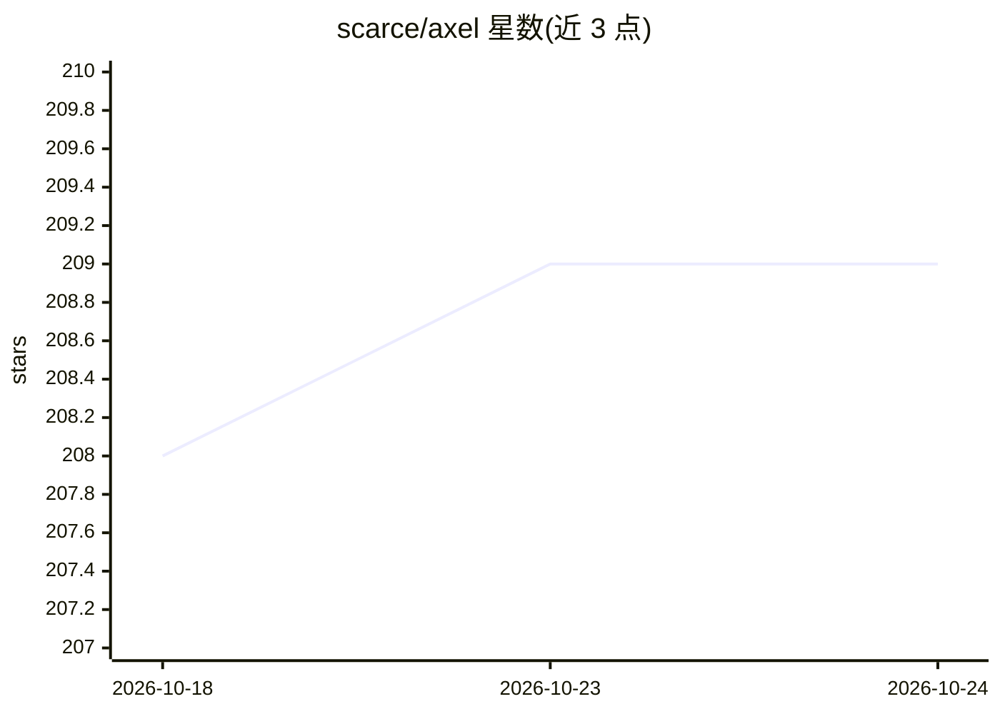

# scarce/axel

⭐ 209 · Swift · 推送 2026-04-28 · [GitHub](https://github.com/scarce/axel) · [官网](https://axel.build) · 个人维护

**macOS 原生任务列表 + AI agent 编排工作台**

由 SwiftUI 原生 macOS 应用与 Rust CLI 组成的 agent 编排工具：将任务队列与真实终端会话（Claude、Codex 等）结合，通过 tmux 分窗、Ghostty 终端与 git worktree 实现一 agent 一分支的隔离运行；应用端提供五栏工作区、SSE 实时收件箱展示 agent 事件与权限请求，用 Automerge CRDT + Supabase 做同步。CLI 读取 AXEL.md 布局与 ./skills 可复用提示。要求 macOS 14+，应用需 Xcode 15+ 从源码构建，自述处于 beta 阶段。

## 筛选速览

| 维度 | 判定 | 备注 |
|---|---|---|
| AI 角色 | `ai-ecosystem` | LLM/agent 周边工具 |
| 许可风险 | `none` | — |
| 部署形态 | `None` |  |
| 模型依赖 | — | README 未给出锁定关系 |
| 硬件要求 | — | 无带数字的原话,不猜 |
| 安装摩擦 | `low` | 无编译、无系统依赖或容器化 |
| 成熟度 | `idea` | |

## 能力要点

- tmux/Ghostty/git worktree 的 agent 隔离运行，一 agent 一分支
- SSE 收件箱实时展示 agent 事件与权限请求，统一审批
- Automerge CRDT + Supabase 无冲突跨设备同步
- Rust CLI 读取 AXEL.md 布局与可复用 skills 提示

## 适用场景

- 并行运行多个 Claude/Codex agent 处理任务队列
- 以任务列表方式追踪各 agent 的运行状态与输出
- 在独立 worktree 中隔离多个 agent 避免互相干扰

## 场景标签

`编码 Agent` `Agent 框架` · 领域:Agent 开发

## 证据(README 行号)

> L5: It pairs a native macOS app with a fast RUST CLI to orchestrate many AI agents across tmux panes, Ghostty based term
> L21: - **Real terminals**: manage live sessions (Claude, Codex, etc.) in tmux panes and Ghostty.

## 星数曲线

2026-10-18 208 → 2026-10-24 209（+1）

---
*卡片 v1 · prompt 1.4 · 生成 2026-10-22 · 置信度 high · 依据 README sha `4e5a6463c115` · [字段定义](../../DATASET.md)*
