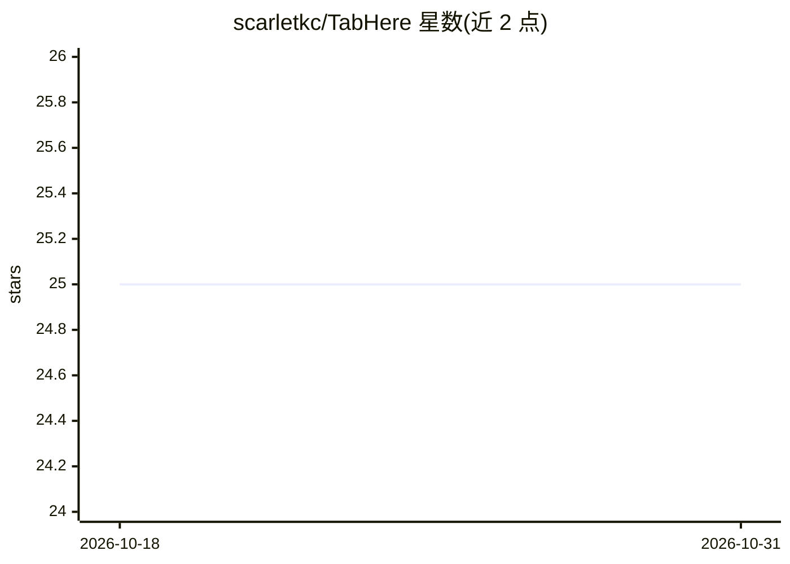

# scarletkc/TabHere

⭐ 25 · TypeScript · MIT · 推送 2025-12-18 · [GitHub](https://github.com/scarletkc/TabHere) · [官网](https://chromewebstore.google.com/detail/oeokpncnejjfjdbpnchhldjdabhppnlb) · 个人维护 · 中文 README

**在网页可编辑区域提供 AI 自动续写补全的 Chrome 扩展**

Chrome 浏览器扩展，调用 AI 在网页上几乎所有可编辑区域提供自动续写/补全。以源码形式提供，通过 npm 安装依赖并构建，产物输出到 dist/，再在 chrome://extensions/ 开发者模式下以 Load unpacked 方式加载；也支持 watch 模式、发布包构建与版本号设置命令。README 列出 Chrome Web Store、隐私政策、Roadmap 链接，采用 MIT 许可证。

## 筛选速览

| 维度 | 判定 | 备注 |
|---|---|---|
| AI 角色 | `ai-enhanced` | 去掉 AI 部分产品仍成立 |
| 许可风险 | `permissive` | MIT |
| 部署形态 | `library` | 以包/库形式分发 |
| 模型依赖 | — | README 未给出锁定关系 |
| 硬件要求 | — | 无带数字的原话,不猜 |
| 安装摩擦 | `low` | 无编译、无系统依赖或容器化 |
| 成熟度 | — | 结构信号不足 |

## 能力要点

- 对网页上几乎所有可编辑区域提供 AI 自动续写/补全
- npm 脚本支持构建、watch 模式与发布包生成
- 以 MIT 许可证发布

## 适用场景

- 在网页表单、编辑器等输入区域获得 AI 补全
- 通过 Chrome 开发者模式加载未打包扩展进行开发调试

## 场景标签

`AI 写作` · 领域:内容生成

## 证据(README 行号)

> L7: TabHere is a Chrome extension that provides AI-powered auto continuation/completion for almost any editable area on 

## 星数曲线

2026-10-18 25 → 2026-10-31 25（+0）

---
*卡片 v1 · prompt 1.4 · 生成 2026-10-26 · 置信度 mid · 依据 README sha `7dcbae796a9f` · [字段定义](../../DATASET.md)*
