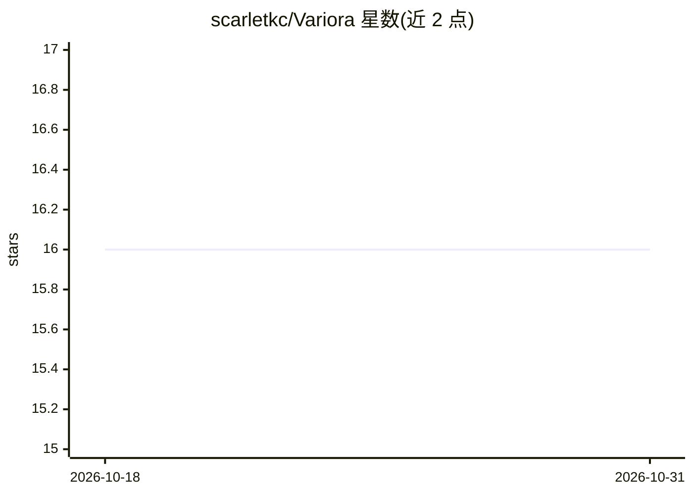

# scarletkc/Variora

⭐ 16 · JavaScript · MIT · 推送 2026-10-13 · [GitHub](https://github.com/scarletkc/Variora) · [官网](http://variora.fog.moe/) · 个人维护

**多模型同题对比的作品集：共享提示词生成的演示与记录**

一个展示型仓库集合：针对同一份共享提示词（PROMPT.md），让不同模型各自实现演示项目，收录源码、截图与记录，供横向查看各模型输出差异。已收录 5 个项目，包括 SVG 插画网页、第一人称贪吃蛇游戏、SVG 动画、以代码谱写并渲染为 MP3 的乐曲等。仓库规定目录结构与模型记录模板，贡献者可复制项目模板添加新的对比条目，并配有网站部署。

## 筛选速览

| 维度 | 判定 | 备注 |
|---|---|---|
| AI 角色 | `ai-knowledge` | 知识聚合/清单类 |
| 许可风险 | `permissive` | MIT |
| 部署形态 | `None` |  |
| 模型依赖 | — | README 未给出锁定关系 |
| 硬件要求 | — | 无带数字的原话,不猜 |
| 安装摩擦 | `low` | 无编译、无系统依赖或容器化 |
| 成熟度 | — | 结构信号不足 |

## 能力要点

- 同一共享提示词下多模型实现的对比集合
- 每条目含源码、截图与模型记录
- 提供项目模板与模型记录模板供添加新对比
- 收录 SVG 动画、游戏、代码谱曲等多类型项目

## 适用场景

- 查看不同模型在同一提示词下的产出差异
- 寻找 AI 生成网页、动画、音乐的示例
- 按模板添加自己的多模型对比记录

## 场景标签

`精选清单` · 领域:学习与行业

## 证据(README 行号)

> L5: Different models, the same brief - a collection of demos built from shared prompts, with source, screenshots, and no
> L33: Copy the project template into `projects/<project>/` and write a concise shared prompt. Each model follows the repo

## 星数曲线

2026-10-18 16 → 2026-10-31 16（+0）

---
*卡片 v1 · prompt 1.4 · 生成 2026-10-30 · 置信度 high · 依据 README sha `f2518e6cac7a` · [字段定义](../../DATASET.md)*
