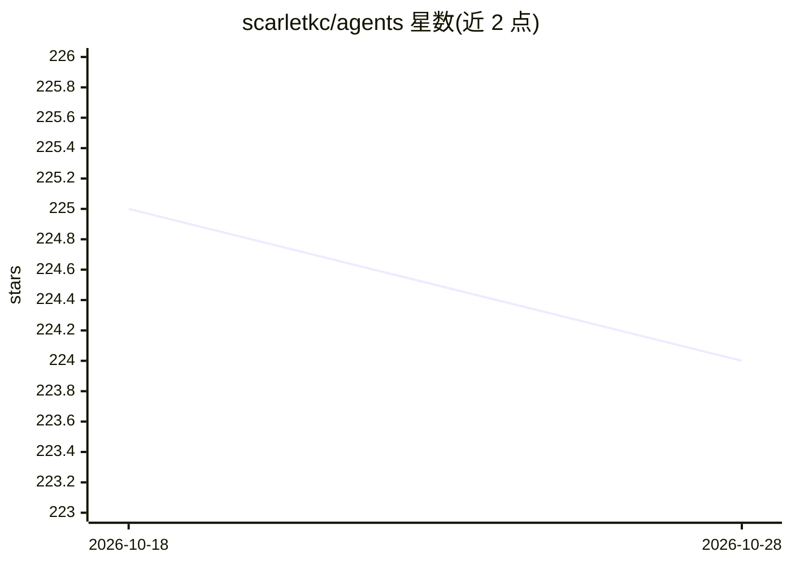

# scarletkc/agents

⭐ 226 · Python · Apache-2.0 · 推送 2026-10-28 · [GitHub](https://github.com/scarletkc/agents) · 个人维护

**面向 AI 编码 agent 的共享规范与可复用技能集**

为 Claude Code、Codex CLI 及其他读取 AGENTS.md 或 SKILL.md 格式的 AI 编码 agent 提供共享规范与技能合集，收录 12 个技能：包括向 Antigravity/Codex/Devin/Grok 等 CLI 委派任务的运行时技能，以及营销文案、产品写作、范围控制、worktree PR 等写作与流程技能。每个技能以 SKILL.md 描述激活条件与指令；通过向 agent 发送提示、GitHub CLI 或 npx skills CLI 三种方式按需安装，另含 Python 打包脚本。Apache-2.0 许可。

## 筛选速览

| 维度 | 判定 | 备注 |
|---|---|---|
| AI 角色 | `ai-knowledge` | 知识聚合/清单类 |
| 许可风险 | `permissive` | Apache-2.0 |
| 部署形态 | `library` | 以包/库形式分发 |
| 模型依赖 | — | README 未给出锁定关系 |
| 硬件要求 | — | 无带数字的原话,不猜 |
| 安装摩擦 | `low` | 无编译、无系统依赖或容器化 |
| 成熟度 | — | 结构信号不足 |

## 能力要点

- 12 个技能，覆盖 CLI 委派、写作、流程控制等类别
- 兼容所有读取 AGENTS.md / SKILL.md 格式的编码 agent
- 支持 gh skill 与 npx skills 两种 CLI 按需选择安装
- 提供 Python 脚本将技能打包为可上传 ZIP

## 适用场景

- 为 Claude Code / Codex CLI 等编码 agent 增加委派、写作、流程类技能
- 在多个编码 agent 间复用统一的工作规范
- 将自有技能打包上传到接受技能的 Web 应用

## 场景标签

`编码 Agent` `提示工程` · 领域:Agent 开发

## 证据(README 行号)

> L3: Shared standards and skills for AI coding agents: Claude Code, Codex CLI,
> L15: Each summary is generated from the skill's own metadata. Open its `SKILL.md`

## 星数曲线

2026-10-18 225 → 2026-10-28 224（-1）

---
*卡片 v1 · prompt 1.4 · 生成 2026-10-22 · 置信度 high · 依据 README sha `1bab18a78ad9` · [字段定义](../../DATASET.md)*
