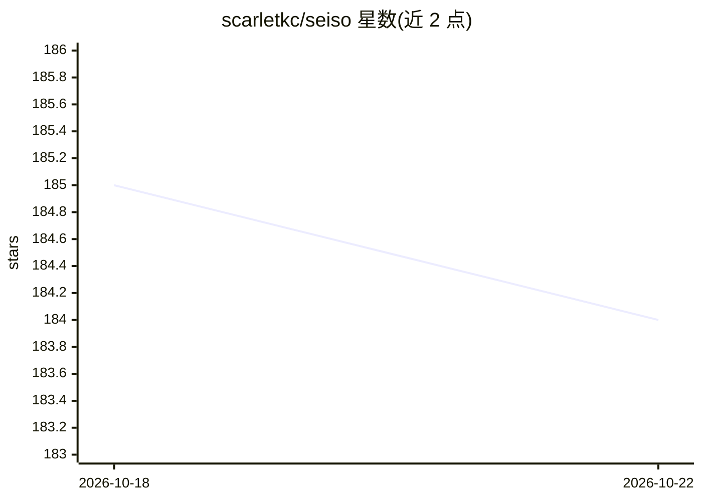

# scarletkc/seiso

⭐ 184 · Rust · MIT · 推送 2026-10-13 · [GitHub](https://github.com/scarletkc/seiso) · [官网](https://seiso.fog.moe) · 个人维护

**面向 AI 编写文档的 Markdown 规范与 linter，供人与 agent 阅读**

seiso 定义一套仓库 Markdown 组织规范（每篇文档声明一种 kind、每个事实只有一个归属页、长期页面不记录易变值等），并作为规范的参考实现提供 lint 工具。诊断信息给出问题位置与修复方式，使 coding agent 可据输出自行修复。规范在 1.0.0 前为暂定版本，预览规则可能误报需显式开启。以 cargo、PyPI、npm 分发，含多平台预编译二进制；提供 Claude Code hooks、pre-commit 与 CI 集成。

## 筛选速览

| 维度 | 判定 | 备注 |
|---|---|---|
| AI 角色 | `ai-ecosystem` | LLM/agent 周边工具 |
| 许可风险 | `permissive` | MIT |
| 部署形态 | `library` | 以包/库形式分发 |
| 模型依赖 | — | README 未给出锁定关系 |
| 硬件要求 | — | 无带数字的原话,不猜 |
| 安装摩擦 | `low` | 无编译、无系统依赖或容器化 |
| 成熟度 | `idea` | |

## 能力要点

- 定义仓库 Markdown 组织规范并提供参考实现 linter
- 诊断输出可直接供 agent 修复文档问题
- 预编译二进制覆盖 macOS/Linux/Windows 多架构
- 提供 Claude Code hooks、pre-commit 与 CI 集成

## 适用场景

- 统一团队或项目内 AI 生成的 Markdown 文档结构
- 在 CI 中检查文档是否符合规范
- 让 coding agent 依据 lint 输出自动修复文档

## 场景标签

 · 领域:开发者工具/文档工程

## 证据(README 行号)

> L5: **A Markdown convention and linter for project docs written by AI and read by humans and agents.**
> L49: seiso is the reference implementation. Its rules check documents against the
> L51: Each diagnostic says where the problem is and how to fix it, so an agent can

## 星数曲线

2026-10-18 185 → 2026-10-22 184（-1）

---
*卡片 v1 · prompt 1.4 · 生成 2026-10-22 · 置信度 high · 依据 README sha `be7c282c6db9` · [字段定义](../../DATASET.md)*
