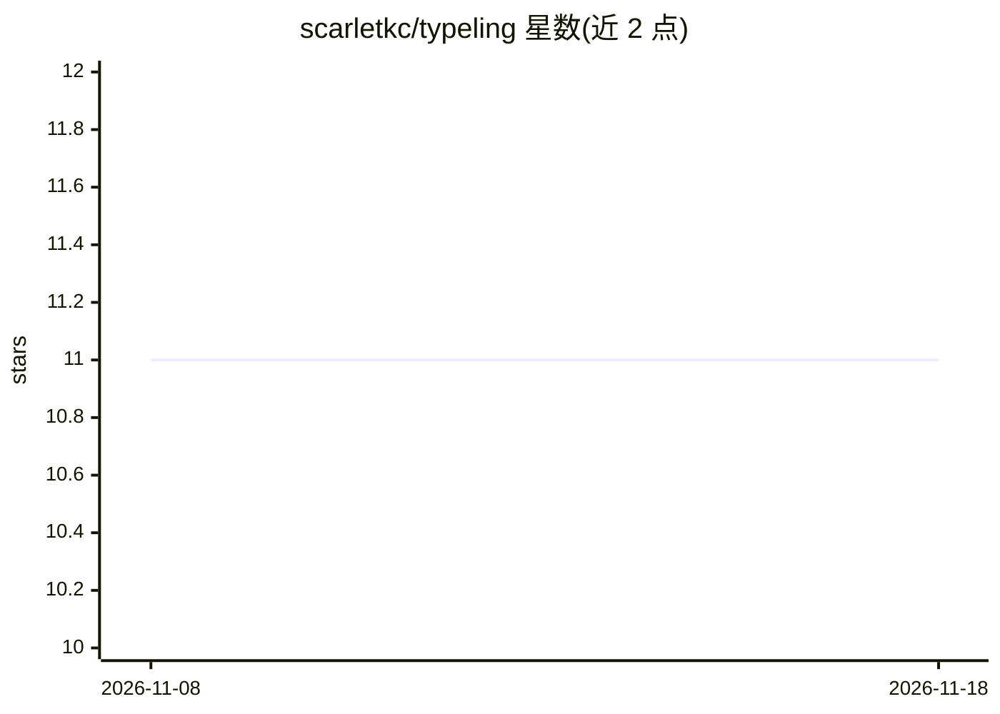

# scarletkc/typeling

⭐ 11 · Python · Apache-2.0 · 推送 2026-11-05 · [GitHub](https://github.com/scarletkc/typeling) · [官网](https://huggingface.co/ScarletKc/Typeling-25M) · 个人维护

**离线英文打字预测库：补全、下一词预测与错字修复**

提供两个同接口的预测器：纯 Python 无依赖的 n-gram 内核（自带 5 MB 模型，Python 3.13+），以及 Typeling-25M——为打字训练的 25M 参数 transformer 语言模型解码器（可选 extra，依赖 PyTorch 与 Transformers）。支持当前词补全、下一词预测、键盘错字修复、本地学习用户词汇并存入 JSON 文件；附带终端演示、延迟基准与训练/评测脚本。面向需要在本地离线运行打字预测的开发者与终端用户，用户输入不离开本机。

## 筛选速览

| 维度 | 判定 | 备注 |
|---|---|---|
| AI 角色 | `ai-native` | 本体是模型或模型工具 |
| 许可风险 | `permissive` | Apache-2.0 |
| 部署形态 | `library` | 以包/库形式分发 |
| 模型依赖 | — | README 未给出锁定关系 |
| 硬件要求 | — | 无带数字的原话,不猜 |
| 安装摩擦 | `medium` | 含编译或系统依赖之一 |
| 成熟度 | — | 结构信号不足 |

## 能力要点

- n-gram 内核纯标准库实现，5 MB 模型毫秒级加载、单次查询数十微秒
- Typeling-25M 支持错字修复（typo_weight 可关），CPU 数十毫秒响应
- 本地学习用户词汇（user.json），输入不离开本机
- 附带 KSR/Precision 评测脚本与语料构建流水线（uv 脚本）

## 适用场景

- 在本地为输入场景提供离线补全与下一词建议
- 在终端体验 ghost text 或候选条的打字预测
- 修复打字时的键盘错字
- 复现模型评测或用自有语料重建模型

## 场景标签

 · 领域:输入工具/语言模型应用

## 证据(README 行号)

> L3: Offline English typing prediction: completes the word being typed, predicts the next word and fixes typos.
> L7: - `typeling.Predictor`: a dependency-free n-gram kernel in pure Python with a bundled 5 MB model.
> L9:  a 25M-parameter transformer language model trained for typing, with typo repair (optional extra

## 星数曲线

2026-11-08 11 → 2026-11-18 11（+0）

---
*卡片 v1 · prompt 1.4 · 生成 2026-11-18 · 置信度 high · 依据 README sha `d3256b8874e7` · [字段定义](../../DATASET.md)*
