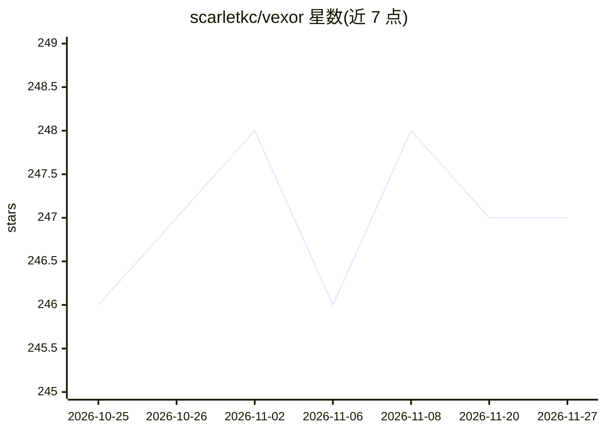

# scarletkc/vexor

⭐ 247 · Python · MIT · 推送 2026-10-31 · [GitHub](https://github.com/scarletkc/vexor) · [官网](https://pypi.org/project/vexor/) · 个人维护 · 中文 README

**为开发者和 AI agent 提供文件与代码的语义搜索**

Vexor 是一个针对文件与代码的语义搜索引擎，构建可复用索引后按语义相似度返回文件路径与预览，省去 grep 模式与目录遍历。核心能力通过 Python API、CLI 和 MCP server 三种入口暴露；嵌入与重排 provider 可配置（openai/gemini/voyageai/custom/local），支持混合重排与本地嵌入实现完全离线使用。索引可缓存、可在 CI 中预热。另附带供 Claude Code、Codex 使用的 agent skill，并已上架官方 MCP registry。MIT 许可。

## 筛选速览

| 维度 | 判定 | 备注 |
|---|---|---|
| AI 角色 | `ai-native` | 本体是模型或模型工具 |
| 许可风险 | `permissive` | MIT |
| 部署形态 | `library` | 以包/库形式分发 |
| 模型依赖 | — | README 未给出锁定关系 |
| 硬件要求 | — | 无带数字的原话,不猜 |
| 安装摩擦 | `low` | 无编译、无系统依赖或容器化 |
| 成熟度 | — | 结构信号不足 |

## 能力要点

- 同一核心提供 Python API、CLI、MCP server 三种入口
- 嵌入与重排 provider 可配置，支持本地嵌入模型离线使用
- 内置 MCP stdio server，暴露 vexor_search 与 vexor_index 两个工具
- 支持混合重排（精确关键词 + 语义融合）与 .vexorignore

## 适用场景

- 忘记文件名或位置时按功能描述找回文件
- 在 agent 工作流中把语义文件搜索作为原生工具接入
- 在 CI 中预热索引以加速检索

## 场景标签

`语义搜索` `RAG` · 领域:知识与检索

## 证据(README 行号)

> L13: **Vexor** is a semantic search engine that builds reusable indexes over files and code.
> L14: It supports configurable embedding and reranking providers, and exposes the same core through a Python API, a CLI t
> L113: Vexor ships a built-in MCP stdio server, so any MCP-capable agent can use semantic file search as a native tool:

## 星数曲线

2026-10-25 246 → 2026-11-27 247（+1）

---
*卡片 v1 · prompt 1.4 · 生成 2026-11-25 · 置信度 high · 依据 README sha `43318a9536b4` · [字段定义](../../DATASET.md)*
