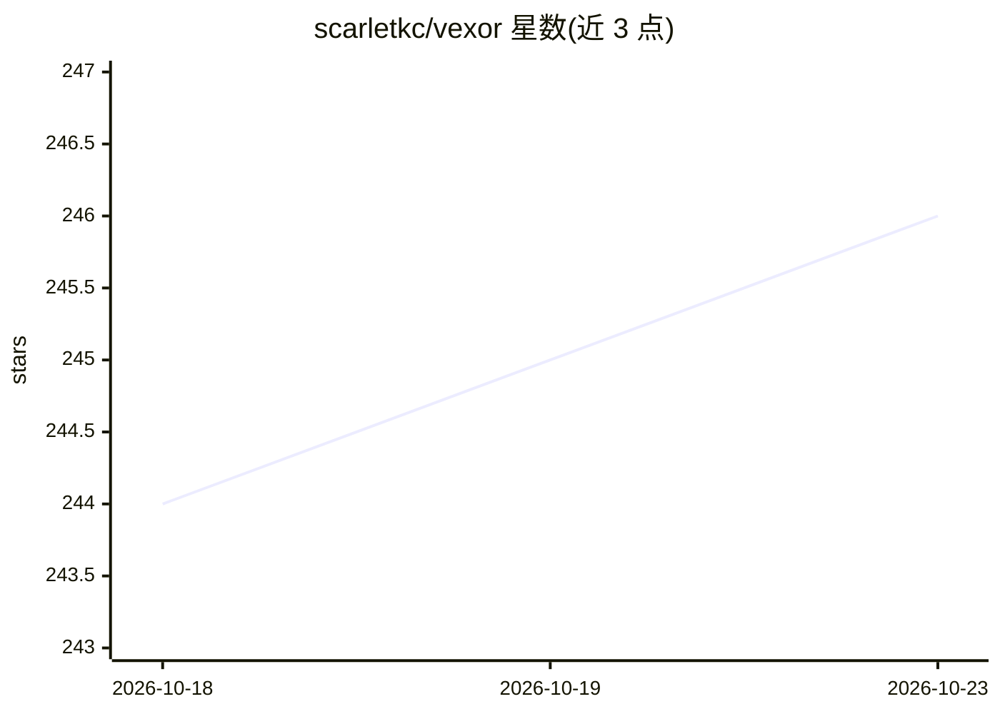

# scarletkc/vexor

⭐ 246 · Python · MIT · 推送 2026-10-02 · [GitHub](https://github.com/scarletkc/vexor) · [官网](https://pypi.org/project/vexor/) · 个人维护 · 中文 README

**面向人类与 AI 助手的文件与代码语义搜索引擎**

对文件与代码构建可复用索引并按语义相似度检索的搜索引擎，通过 Python API、CLI 与内置 MCP stdio server 三种形式暴露同一核心。支持可配置的嵌入与重排提供商（openai/gemini/voyageai/custom/local），提供混合关键词+语义重排、多种索引模式、项目级配置与完全离线的本地嵌入模型。附带面向 Claude Code 与 Codex 的 Agent Skill 安装命令，并列入官方 MCP registry。

## 筛选速览

| 维度 | 判定 | 备注 |
|---|---|---|
| AI 角色 | `ai-native` | 本体是模型或模型工具 |
| 许可风险 | `permissive` | MIT |
| 部署形态 | `library` | 以包/库形式分发 |
| 模型依赖 | locked-api |  |
| 硬件要求 | — | 无带数字的原话,不猜 |
| 安装摩擦 | `low` | 无编译、无系统依赖或容器化 |
| 成熟度 | — | 结构信号不足 |

## 能力要点

- 同一核心暴露为 Python API、CLI 与 MCP server 三种形式
- 可配置嵌入/重排提供商，支持本地模型完全离线使用
- vexor_search 直接返回匹配源文本，减少后续文件读取
- 提供面向 Claude Code / Codex 的 Agent Skill 安装

## 适用场景

- 记得文件功能但忘了名字时按语义定位文件
- 让 Claude Code / Codex 等 AI 助手在自主工作流中语义查找代码
- 在 Cursor / Windsurf 等 MCP 客户端中把语义搜索作为原生工具调用

## 场景标签

`语义搜索` · 领域:知识与检索

## 证据(README 行号)

> L13: **Vexor** is a semantic search engine that builds reusable indexes over files and code.
> L33: Designed for both humans and AI coding assistants, enabling semantic file discovery in autonomous agent workflows.
> L137: vexor config --set-provider openai     # default; also gemini/voyageai/custom/local

## 星数曲线

2026-10-18 244 → 2026-10-23 246（+2）

---
*卡片 v1 · prompt 1.4 · 生成 2026-10-22 · 置信度 high · 依据 README sha `9fd7f8a7669c` · [字段定义](../../DATASET.md)*
