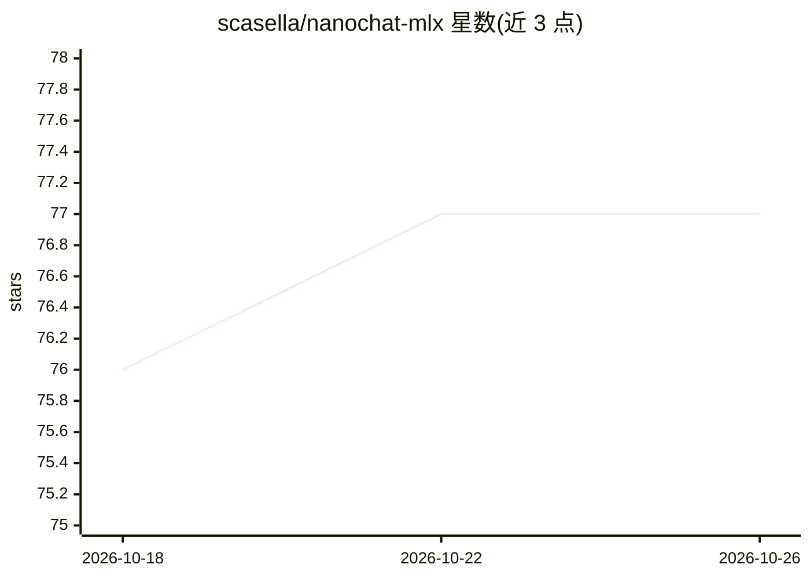

# scasella/nanochat-mlx

⭐ 77 · Python · MIT · 推送 2026-04-29 · [GitHub](https://github.com/scasella/nanochat-mlx) · [官网](https://casella.dev/projects.html) · 个人维护

**在 Apple Silicon 上从零训练并对话自有 ChatGPT 的 MLX 工具**

Karpathy nanochat 的 MLX 移植：在 MacBook 上无 PyTorch 完成数据下载、tokenizer 训练、预训练、SFT、评测与聊天的全流程。单一 --depth 参数按 scaling law 自动推算模型规模、学习率与训练时长（depth 4 约 5M 参数 1 分钟，depth 26 约 600M 参数复现 GPT-2 规模）。提供 Web GUI 向导与 CLI 两种方式，也可从 HuggingFace 导入预训练 checkpoint 跳过训练。要求 Apple Silicon（M1-M4），推荐 RAM 按深度 8-32GB+ 分级。

## 筛选速览

| 维度 | 判定 | 备注 |
|---|---|---|
| AI 角色 | `ai-native` | 本体是模型或模型工具 |
| 许可风险 | `permissive` | MIT |
| 部署形态 | `None` |  |
| 模型依赖 | — | README 未给出锁定关系 |
| 硬件要求 | — | 无带数字的原话,不猜 |
| 安装摩擦 | `low` | 无编译、无系统依赖或容器化 |
| 成熟度 | — | 结构信号不足 |

## 能力要点

- 单一 --depth 参数按 scaling law 自动设置全部超参数
- 全流程覆盖：数据下载→tokenizer→预训练→SFT→聊天→评测
- Web GUI quickstart 向导与完整 CLI 两种使用方式
- 支持从 HuggingFace 导入预训练 checkpoint 免训练

## 适用场景

- 在自家 MacBook 上从零训练一个可对话的小型语言模型
- 学习 GPT 训练全流程（tokenizer/预训练/SFT）的动手实验
- 复现 GPT-2 规模（约 600M 参数）的本地训练

## 场景标签

`模型训练` `教程课程` · 领域:学习与行业

## 证据(README 行号)

> L13: A self-contained MLX port of nanochat that runs entirely on Apple Silicon. One complexity dial (`--depth`) controls
> L16: - Full pipeline: data download, tokenizer training, pretraining, SFT, chat, evaluation

## 星数曲线

2026-10-18 76 → 2026-10-26 77（+1）

---
*卡片 v1 · prompt 1.4 · 生成 2026-10-24 · 置信度 high · 依据 README sha `508e0e46a31f` · [字段定义](../../DATASET.md)*
