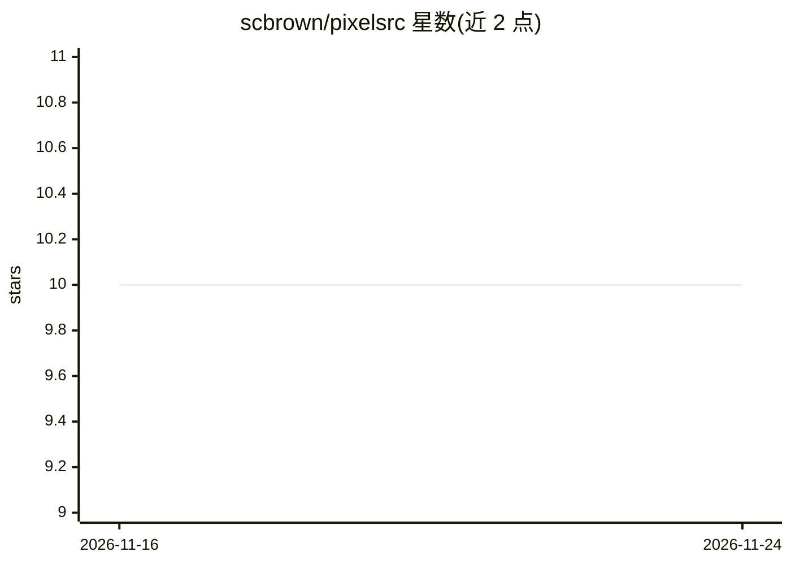

# scbrown/pixelsrc

⭐ 10 · Rust · MIT · 推送 2026-11-23 · [GitHub](https://github.com/scbrown/pixelsrc) · [官网](https://scbrown.github.io/pixelsrc/) · 个人维护

**面向 GenAI 的语义化像素画文本格式与编译器**

pixelsrc 是一种 JSON5 文本格式及 Rust 编写的编译器（CLI 工具 pxl），用语义区域（rect/circle/polygon 等）而非逐像素定义像素画，编译器负责解析为像素并渲染成 PNG/GIF/精灵表，支持调色板、动画、图层组合与状态规则，可从 PNG 反向导入。定位为面向 AI 系统可靠生成的像素画格式（描述意图、编译器解析像素），提供 Web 编辑器、WASM 模块与 Obsidian 插件集成。默认宽容解析、CI 可用严格模式。

## 筛选速览

| 维度 | 判定 | 备注 |
|---|---|---|
| AI 角色 | `ai-enhanced` | 去掉 AI 部分产品仍成立 |
| 许可风险 | `permissive` | MIT |
| 部署形态 | `desktop` | 安装包/桌面程序 |
| 模型依赖 | — | README 未给出锁定关系 |
| 硬件要求 | — | 无带数字的原话,不猜 |
| 安装摩擦 | `low` | 无编译、无系统依赖或容器化 |
| 成熟度 | — | 结构信号不足 |

## 能力要点

- 语义区域定义（rect/circle/polygon/fill），编译器解析像素，64x64 与 8x8 结构描述空间相近
- pxl CLI：渲染 PNG/GIF、生成精灵表、格式化、校验、PNG 导入、内置调色板
- WASM 模块可在 JavaScript/TypeScript 中使用，另有 Web 编辑器与 Obsidian 插件
- JSON5 格式支持注释与宽松解析，另有 CI 用的严格模式

## 适用场景

- 配合 AI 助手生成游戏精灵图
- 视觉资产的快速原型迭代
- 像素画以文本形式做版本控制 diff
- 通过可读定义学习像素画

## 场景标签

 · 领域:游戏开发/图形工具

## 证据(README 行号)

> L13: **The first pixel art format designed for GenAI.**
> L15: pixelsrc is a semantic, human-readable text format for defining pixel art. Unlike traditional editors or hex-based 
> L28: - **GenAI-native** - Describe intent, the compiler resolves pixels

## 星数曲线

2026-11-16 10 → 2026-11-24 10（+0）

---
*卡片 v1 · prompt 1.4 · 生成 2026-11-19 · 置信度 high · 依据 README sha `45fbf0faf504` · [字段定义](../../DATASET.md)*
