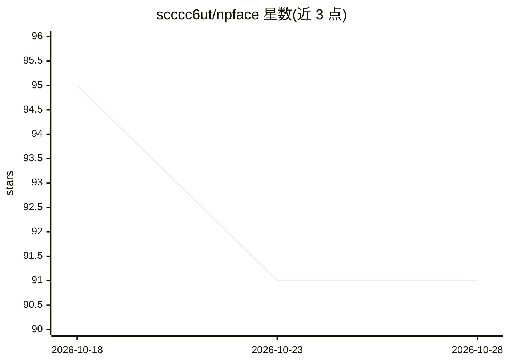

# scccc6ut/npface

⭐ 91 · TypeScript · MIT · 推送 2026-08-20 · [GitHub](https://github.com/scccc6ut/npface) · [官网](https://scccc6ut.github.io/npface/) · 个人维护 · 中文 README

**AI agent 用的零依赖 SVG 头盔表情头像组件**

npface 是一个 TypeScript 前端库，渲染一个头盔形状的小脸（SVG，两眼+护目镜+头盔动作），通过传入语义状态名（thinking、search-docs、search-web、working、waiting、error 等 13 种）驱动表情与动作。零依赖、框架无关核心约 9 KB gzip，共享单个 rAF 循环；提供 React 绑定 npface-react，支持 CDN 引入。面向需要为 AI agent 展示工作状态的开发者：后端只需随事件发送状态名即可切换表情，无需服务端动画逻辑。支持自定义状态注册、配色主题、离屏暂停与 prefers-reduced-motion 无障碍处理。MIT 许可。

## 筛选速览

| 维度 | 判定 | 备注 |
|---|---|---|
| AI 角色 | `ai-enhanced` | 去掉 AI 部分产品仍成立 |
| 许可风险 | `permissive` | MIT |
| 部署形态 | `library` | 以包/库形式分发 |
| 模型依赖 | — | README 未给出锁定关系 |
| 硬件要求 | — | 无带数字的原话,不猜 |
| 安装摩擦 | `low` | 无编译、无系统依赖或容器化 |
| 成熟度 | — | 结构信号不足 |

## 能力要点

- 13 个语义状态驱动表情（thinking/search-docs/search-web/working/error 等），支持别名与自定义状态注册
- 零依赖核心，gzip 约 9 KB，共享单个 requestAnimationFrame 循环
- 提供 React 绑定 npface-react，兼容 Next.js App Router，也支持 CDN 无构建使用
- 状态即数据：表情定义为纯数据文件，与渲染逻辑分离

## 适用场景

- 给 AI agent 界面加一个会随工作状态变化的头像
- 通过 SSE/WebSocket 状态流实时展示 agent 的检索、思考、执行过程
- 在任意前端框架中以 CDN 或 npm 方式嵌入轻量表情动画

## 场景标签

 · 领域:前端/开发者组件

## 证据(README 行号)

> L21: `npface` renders a small helmet-shaped face — a deep-navy rounded square helmet, white visor slot, two neon-green r
> L155: The backend only needs to emit a **state name** alongside its usual events; no animation logic server-side.

## 星数曲线

2026-10-18 95 → 2026-10-28 91（-4）

---
*卡片 v1 · prompt 1.4 · 生成 2026-10-23 · 置信度 high · 依据 README sha `f22c7967b7fe` · [字段定义](../../DATASET.md)*
