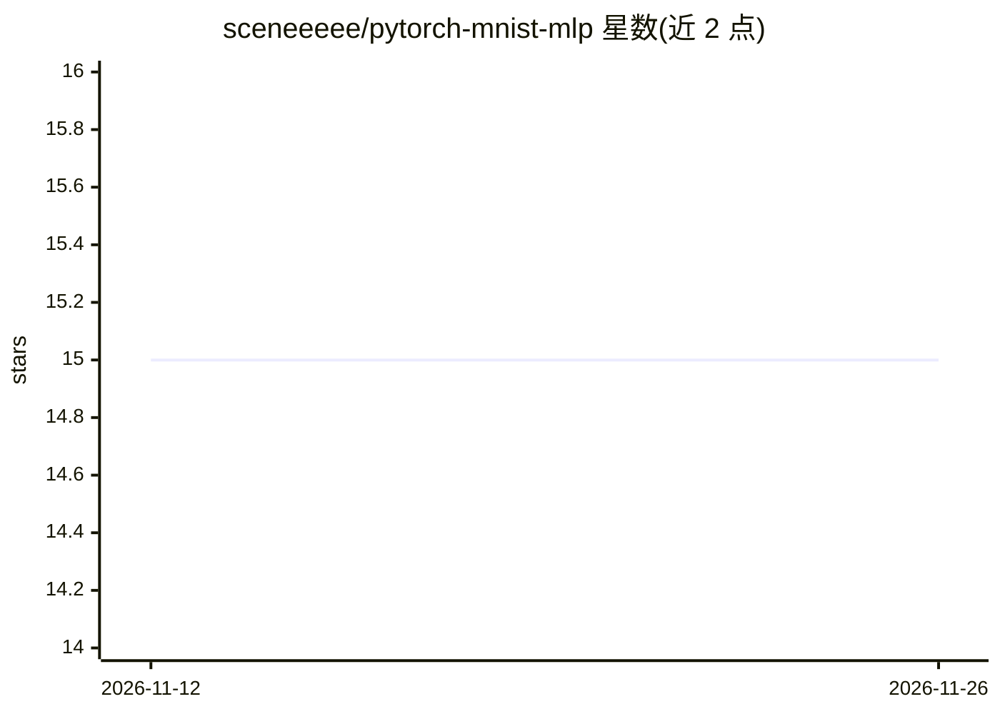

# sceneeeee/pytorch-mnist-mlp

⭐ 15 · Python · MIT · 推送 2026-06-28 · [GitHub](https://github.com/sceneeeee/pytorch-mnist-mlp) · 个人维护

**面向初学者的 PyTorch MLP 手写数字分类入门项目**

一个入门级 PyTorch 项目：训练小型多层感知机（784→128→10）对 MNIST 手写数字做分类。覆盖完整流程：下载与查看数据集、训练五个 epoch、测试集评估、以 state_dict 形式保存与加载 checkpoint、以及展示单条预测。README 附带模型结构说明、SGD/CrossEntropyLoss 机制解释与训练结果（测试准确率约 93%）。要求 Python 3.10、PyTorch 2.x，CPU 即可运行，MIT 许可。

## 筛选速览

| 维度 | 判定 | 备注 |
|---|---|---|
| AI 角色 | `ai-native` | 本体是模型或模型工具 |
| 许可风险 | `permissive` | MIT |
| 部署形态 | `library` | 以包/库形式分发 |
| 模型依赖 | — | README 未给出锁定关系 |
| 硬件要求 | — | 无带数字的原话,不猜 |
| 安装摩擦 | `low` | 无编译、无系统依赖或容器化 |
| 成熟度 | — | 结构信号不足 |

## 能力要点

- 完整流程脚本：数据查看、训练、评估、checkpoint 保存/加载、推理示例
- MLP 结构（Flatten→Linear784,128→ReLU→Linear128,10）与训练机制在 README 中逐项说明
- CPU-only 即可运行，五 epoch 测试准确率约 93%

## 适用场景

- 学习 PyTorch 基础训练/评估/checkpoint 流程
- 作为 MNIST 分类入门教学示例运行与修改
- 验证本机 PyTorch CPU 环境是否正常工作

## 场景标签

`教程课程` · 领域:学习与行业

## 证据(README 行号)

> L8: A beginner PyTorch project that trains a small multilayer perceptron (MLP) to classify handwritten digits from the M
> L45: MNIST images arrive in batches with shape `[batch, 1, 28, 28]`. The network consists of:

## 星数曲线

2026-11-12 15 → 2026-11-26 15（+0）

---
*卡片 v1 · prompt 1.4 · 生成 2026-11-18 · 置信度 high · 依据 README sha `7af093aa2e42` · [字段定义](../../DATASET.md)*
