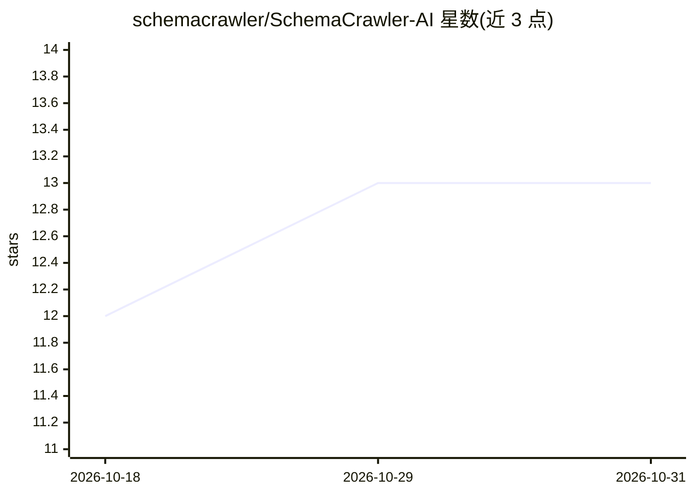

# schemacrawler/SchemaCrawler-AI

⭐ 13 · Java · NOASSERTION · 推送 2026-10-30 · [GitHub](https://github.com/schemacrawler/SchemaCrawler-AI) · 组织维护

**让 AI agent 通过 MCP 交互查询数据库 schema 元数据的 MCP 服务器**

基于 SchemaCrawler 的 MCP 服务器，为 AI agent 提供交互式读取数据库 schema 元数据的通道，底层复用 SchemaCrawler 的数据库结构与元数据发现能力。面向需要让 AI 助手理解数据库结构的开发者和企业用户。采用 BUSL-1.1 许可：可自由阅读、修改和再分发源码，但生产或商业用途需另行商业授权；随附的 JDBC 驱动等第三方组件按各自许可分发。提供 Docker 镜像。

## 筛选速览

| 维度 | 判定 | 备注 |
|---|---|---|
| AI 角色 | `ai-ecosystem` | LLM/agent 周边工具 |
| 许可风险 | `none` | NOASSERTION |
| 部署形态 | `self-host` | docker 或自建部署 |
| 模型依赖 | — | README 未给出锁定关系 |
| 硬件要求 | — | 无带数字的原话,不猜 |
| 安装摩擦 | `low` | 无编译、无系统依赖或容器化 |
| 成熟度 | — | 结构信号不足 |

## 能力要点

- 以 MCP 服务器形式向 AI agent 暴露数据库 schema 元数据
- 基于 SchemaCrawler 的数据库结构发现能力
- 提供 Docker 镜像与 Docker MCP 镜像

## 适用场景

- 让 AI 编程助手在写 SQL 前查询表结构与元数据
- 通过 MCP 协议向 agent 提供数据库 schema 上下文
- 数据库逆向理解与文档化的 AI 辅助场景

## 场景标签

 · 领域:数据库工具/AI 基础设施

## 证据(README 行号)

> L16: **SchemaCrawler AI** provides an MCP Server to allow AI agents to have an interactive way to interrogate your datab
> L20: **SchemaCrawler AI** is licensed under the Business Source License 1.1 (BUSL-1.1) license.

## 星数曲线

2026-10-18 12 → 2026-10-31 13（+1）

---
*卡片 v1 · prompt 1.4 · 生成 2026-10-31 · 置信度 mid · 依据 README sha `2f1793d7ca1c` · [字段定义](../../DATASET.md)*
