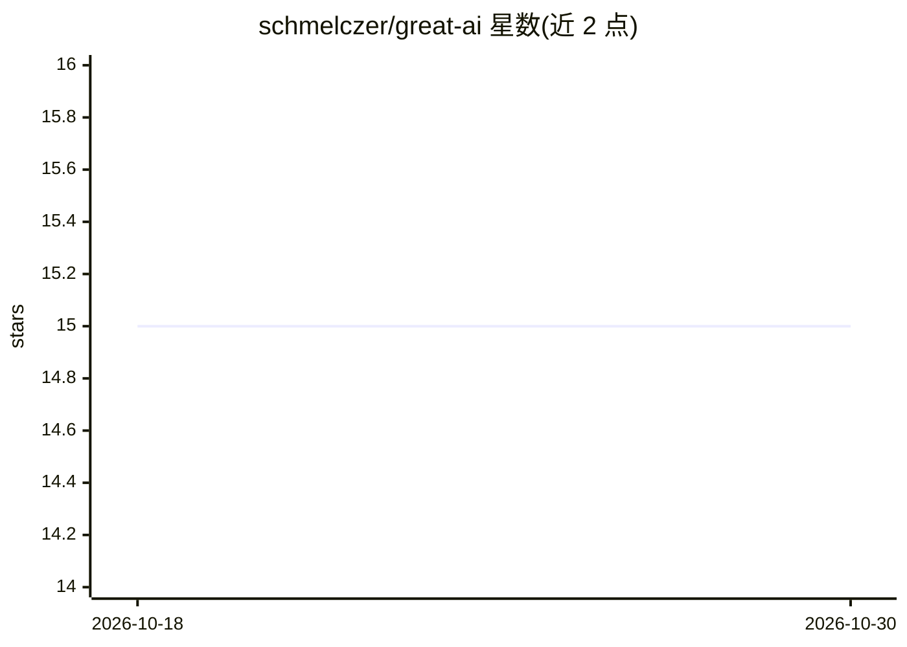

# schmelczer/great-ai

⭐ 15 · Python · GPL-3.0 · 推送 2026-10-28 · [GitHub](https://github.com/schmelczer/great-ai) · [官网](https://great-ai.scoutinscience.com) · 个人维护

**把原型 AI 代码自动配置为可部署服务的 Python 框架**

Python 框架，定位在 AI 开发生命周期的原型与部署阶段之间：通过装饰器 API（@GreatAI.create）将函数包装为服务，自动实现多项 SE4ML 最佳实践，包括追踪（默认本地 TinyDB）、模型版本管理与 API 脚手架，并在 localhost:6060 提供仪表盘。支持任意 Python 库、内置端到端反馈概念。README 声明这些工程功能支持监督，不构成模型准确性或可信度的保证。生产前需替换默认追踪数据库并配置存储与部署基础设施。

## 筛选速览

| 维度 | 判定 | 备注 |
|---|---|---|
| AI 角色 | `ai-ecosystem` | LLM/agent 周边工具 |
| 许可风险 | `viral` | GPL-3.0 |
| 部署形态 | `self-host` | docker 或自建部署 |
| 模型依赖 | — | README 未给出锁定关系 |
| 硬件要求 | — | 无带数字的原话,不猜 |
| 安装摩擦 | `low` | 无编译、无系统依赖或容器化 |
| 成熟度 | — | 结构信号不足 |

## 能力要点

- 装饰器 API 将函数包装为带追踪与版本管理的服务
- 自动实现多项 SE4ML 最佳实践（可自定义）
- 内置仪表盘（localhost:6060）与端到端反馈概念
- 容器镜像支持 Linux AMD64 与 ARM64

## 适用场景

- 把机器学习原型快速包装为可部署的 REST 服务
- 为 AI 服务添加请求追踪与模型版本管理
- 通过仪表盘监督已部署 AI 应用的运行情况

## 场景标签

`MLOps` · 领域:训练与推理

## 证据(README 行号)

> L10: Applying AI is becoming increasingly more accessible, but many case studies have shown that these applications are 
> L27: @GreatAI.create

## 星数曲线

2026-10-18 15 → 2026-10-30 15（+0）

---
*卡片 v1 · prompt 1.4 · 生成 2026-10-30 · 置信度 high · 依据 README sha `cff9920dccde` · [字段定义](../../DATASET.md)*
