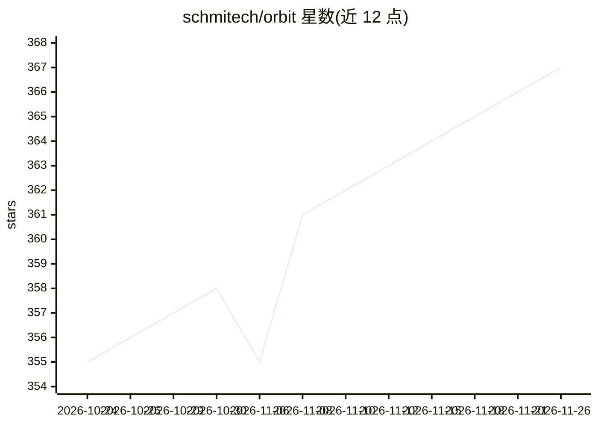

# schmitech/orbit

⭐ 367 · Python · Apache-2.0 · 推送 2026-11-24 · [GitHub](https://github.com/schmitech/orbit) · [官网](https://schmitech.ai) · 组织维护

**自托管 AI 网关：私有 RAG、自然语言查数据与 MCP 工具调用**

ORBIT 是一个自托管的 AI 网关、检索引擎与 agent 宿主，Apache 2.0 单许可。通过 YAML 配置的适配器连接文件、SQL、NoSQL、向量库与 API，提供混合检索与重排序；对外暴露一个 OpenAI 兼容 API，可接入本地或托管模型并支持 provider 回退；支持 MCP 工具、技能路由与 A2A 协调；内置 SSO、RBAC、PII 检测、配额、审计日志与管理面板。以 Docker 镜像（5 种 flavor）或源码方式运行。

## 筛选速览

| 维度 | 判定 | 备注 |
|---|---|---|
| AI 角色 | `ai-ecosystem` | LLM/agent 周边工具 |
| 许可风险 | `permissive` | Apache-2.0 |
| 部署形态 | `self-host` | docker 或自建部署 |
| 模型依赖 | local-ok | 支持本地模型 |
| 硬件要求 | — | 无带数字的原话,不猜 |
| 安装摩擦 | `low` | 无编译、无系统依赖或容器化 |
| 成熟度 | — | 结构信号不足 |

## 能力要点

- 一个 OpenAI 兼容 API 统一接入本地/托管模型，带自动模型选择与 provider 回退
- YAML 适配器连接文件、SQL、NoSQL、向量库与 API，混合检索与重排序
- MCP 工具调用、技能路由与 A2A agent 协调
- 内置 SSO、RBAC、PII 检测、配额、审计日志与管理 UI

## 适用场景

- 自托管环境对 PDF/文档/数据库做私有问答与 RAG
- 用自然语言查询企业 SQL/NoSQL/ES 数据
- 为 agent 接入 MCP 工具并做集中管理
- 内网或气隙环境用本地模型部署 LLM 服务

## 场景标签

`RAG` `数据分析` `模型网关` · 领域:Agent 开发

## 证据(README 行号)

> L9:  Ask questions about a PDF, query a SQL database, or call an MCP tool through one OpenAI-compatible API.
> L31: An AI gateway, retrieval engine, and agent host in one Apache 2.0 project, with no gated features.
> L36: |**Your choice of models**|Use local or hosted models through one OpenAI-compatible API, with automatic model selec

## 星数曲线

2026-10-24 355 → 2026-11-26 367（+12）

---
*卡片 v1 · prompt 1.4 · 生成 2026-11-25 · 置信度 high · 依据 README sha `eb25651fa7b5` · [字段定义](../../DATASET.md)*
