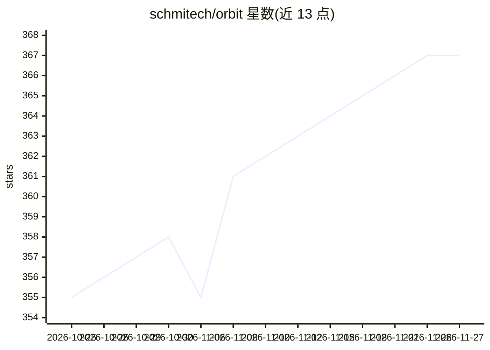

# schmitech/orbit

⭐ 367 · Python · Apache-2.0 · 推送 2026-11-24 · [GitHub](https://github.com/schmitech/orbit) · [官网](https://schmitech.ai) · 组织维护

**自托管 AI 网关：私有 RAG、自然语言数据查询与工具调用**

ORBIT 是一个自托管的开源 AI 网关，将检索引擎、代理托管与 OpenAI 兼容 API 汇聚于同一 Apache 2.0 项目。通过 YAML 配置适配器连接文件、SQL、NoSQL、向量库与 API，提供混合检索与重排序；支持本地或托管模型、自动模型选择与提供商回退；可接入 MCP 工具并通过 A2A 协调代理；内置 SSO、角色权限、PII 检测、审计日志与成本估算，并提供管理面板。支持本地模型实现空气隔离部署。

## 筛选速览

| 维度 | 判定 | 备注 |
|---|---|---|
| AI 角色 | `ai-ecosystem` | LLM/agent 周边工具 |
| 许可风险 | `permissive` | Apache-2.0 |
| 部署形态 | `self-host` | docker 或自建部署 |
| 模型依赖 | local-ok | 支持本地模型 |
| 硬件要求 | — | 无带数字的原话,不猜 |
| 安装摩擦 | `low` | 无编译、无系统依赖或容器化 |
| 成熟度 | — | 结构信号不足 |

## 能力要点

- 统一的 OpenAI 兼容 API 接入本地与托管模型，含自动模型选择与提供商回退
- YAML 配置适配器连接文件、SQL、NoSQL、向量库，支持混合检索与重排序
- MCP 工具调用、技能路由与 A2A 代理协调
- 内置 SSO、RBAC、PII 检测、配额、审计日志与成本估算及管理面板

## 适用场景

- 让团队用自然语言查询私有文档与数据库
- 自建空气隔离环境下的本地模型推理服务
- 统一管理多个 LLM 提供商的 API 密钥与配额
- 为代理接入 MCP 工具并做集中审计

## 场景标签

`AI 助手` `RAG` `模型网关` `数据分析` · 领域:Agent 开发

## 证据(README 行号)

> L9:  Ask questions about a PDF, query a SQL database, or call an MCP tool through one OpenAI-compatible API.
> L31: An AI gateway, retrieval engine, and agent host in one Apache 2.0 project, with no gated features.
> L36: |**Your choice of models**|Use local or hosted models through one OpenAI-compatible API, with automatic model selec

## 星数曲线

2026-10-25 355 → 2026-11-27 367（+12）

---
*卡片 v1 · prompt 1.4 · 生成 2026-11-26 · 置信度 high · 依据 README sha `fb6303559fc7` · [字段定义](../../DATASET.md)*
