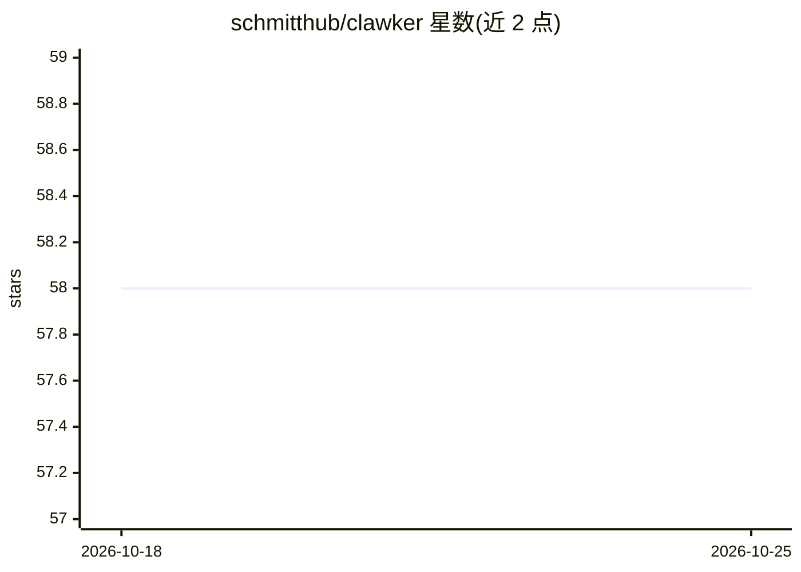

# schmitthub/clawker

⭐ 58 · Go · MIT · 推送 2026-10-25 · [GitHub](https://github.com/schmitthub/clawker) · [官网](https://docs.clawker.dev) · 个人维护

**自托管的 AI 编码 agent 沙箱平台：在 Docker 隔离容器中运行 Claude Code/Codex 等 CLI**

一个 CLI 工具与控制平面，把 Claude Code、OpenAI Codex 等 AI 编码 agent CLI 运行在隔离的 Docker 容器中，任何装了 Docker 的 macOS/Linux 主机可用。机制上：控制平面容器管理防火墙生命周期、eBPF 出站过滤（默认拒绝、域名白名单、Envoy TLS 终结做路径/方法级规则）；每容器 clawkerd 守护进程降权并以 PID 1 监管 harness；无 Dockerfile，基于固定 Debian 基底镜像按项目自定义包、语言栈与指令；支持主机设置/技能/插件暂存、Git 凭证转发、worktree 管理、可选 OTel+OpenSearch+Prometheus 监控。Windows 不支持。

## 筛选速览

| 维度 | 判定 | 备注 |
|---|---|---|
| AI 角色 | `ai-ecosystem` | LLM/agent 周边工具 |
| 许可风险 | `permissive` | MIT |
| 部署形态 | `self-host` | docker 或自建部署 |
| 模型依赖 | — | README 未给出锁定关系 |
| 硬件要求 | — | 无带数字的原话,不猜 |
| 安装摩擦 | `low` | 无编译、无系统依赖或容器化 |
| 成熟度 | — | 结构信号不足 |

## 能力要点

- 多 harness 设计：Claude Code/Codex 内置，可自行编写 bundle 接入任意编码 agent CLI
- 默认启用的 L4-L7 防火墙栈：eBPF 出站过滤 + CoreDNS 域名白名单 + Envoy per-domain MITM 做路径/方法级规则
- 免写 Dockerfile 的两级镜像构建：共享项目 base 镜像 + 薄 harness 层
- 主机设置/凭证/插件/技能暂存与浏览器认证代理，登录跨容器重启持久化

## 适用场景

- 在隔离沙箱中用 --dangerously-skip-permissions 跑编码 agent，免反复审批
- 多个 agent 在不同 worktree 并行处理分支任务
- 为编码 agent 做出站网络白名单管控与审计监控

## 场景标签

 · 领域:AI 编码 agent 基础设施/开发者工具

## 证据(README 行号)

> L3: <code>clawker</code> is a free, open-source, self-hosted AI coding agent sandbox — a CLI that runs agent harnesses l
> L11: - **Multi-harness by design** — `Claude Code` and `OpenAI Codex` ship as embedded **harness bundles**, and any codi
> L23: - **L4-L7 firewall stack** enabled by default — eBPF cgroup programs attached from outside the container get a verd

## 星数曲线

2026-10-18 58 → 2026-10-25 58（+0）

---
*卡片 v1 · prompt 1.4 · 生成 2026-10-24 · 置信度 mid · 依据 README sha `985394c27076` · [字段定义](../../DATASET.md)*
