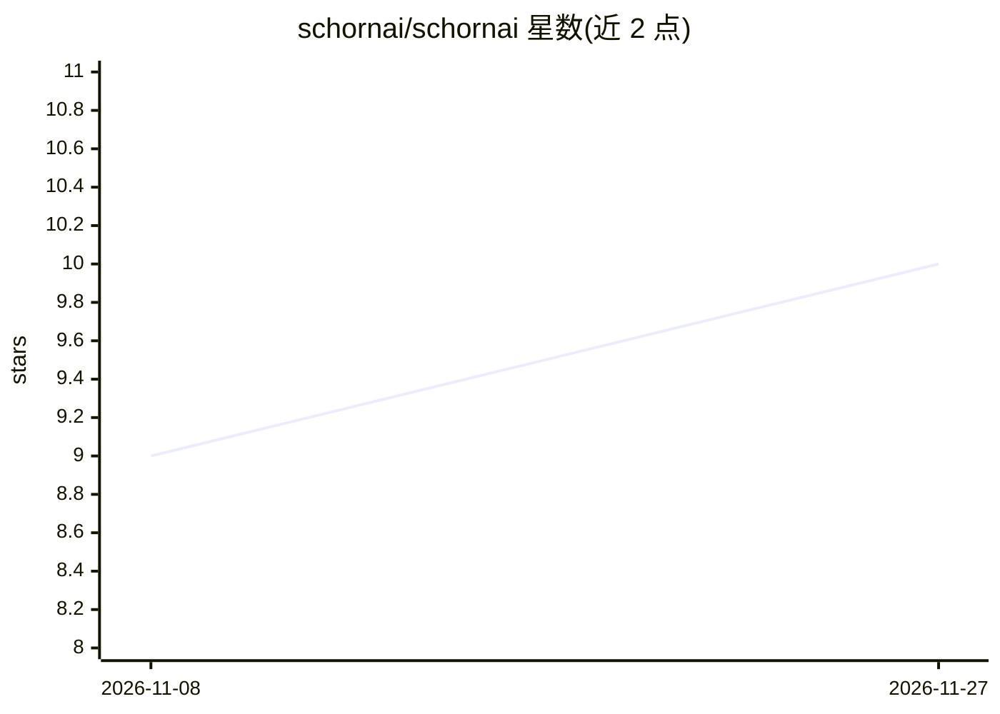

# schornai/schornai

⭐ 10 · TypeScript · AGPL-3.0 · 推送 2026-11-26 · [GitHub](https://github.com/schornai/schornai) · [官网](https://schorn.ai) · 组织维护

**团队自托管 AI 工作区：构建 Agent、检索文档、转录音频**

将 AI Agent、文档搜索与音频转录整合到同一自托管工作区，通过共享 Web 界面向团队提供访问。Agent 可配置角色、指令、模型、文档访问与工具（含工具执行前审批）；文档存于共享仓库并抽取内容供 Agent 检索；转录依赖 Apple Silicon 上的 MLX Whisper。模型可选本地 Ollama 或外部提供商及 OpenAI 兼容端点；支持 MCP 集成、用户/权限/SSO 管理，机器服务支持 macOS Apple Silicon 与 Linux ARM64/x64，源码运行需 Node.js 24+。

## 筛选速览

| 维度 | 判定 | 备注 |
|---|---|---|
| AI 角色 | `ai-ecosystem` | LLM/agent 周边工具 |
| 许可风险 | `viral` | AGPL-3.0 |
| 部署形态 | `None` |  |
| 模型依赖 | local-ok | 支持本地模型 |
| 硬件要求 | — | 无带数字的原话,不猜 |
| 安装摩擦 | `low` | 无编译、无系统依赖或容器化 |
| 成熟度 | — | 结构信号不足 |

## 能力要点

- Agent 配置角色、指令、模型、文档访问与工具执行前审批
- 本地 Ollama 或外部提供商（OpenAI/Anthropic/Google/Mistral）及 OpenAI 兼容端点
- MLX Whisper 在 Apple Silicon 上本地转录音频与视频
- MCP 集成、每用户 OAuth、平台 MCP 访问的四级权限

## 适用场景

- 团队自托管部署，数据不出本地基础设施地使用 AI Agent
- 将共享文档库接入 Agent 检索问答
- 在 Apple Silicon 上本地转录和编辑会议录音

## 场景标签

`RAG` `语音识别` `AI 助手` · 领域:对话与助手

## 证据(README 行号)

> L7: schorn.ai brings AI agents, document search, and audio transcription into one
> L24: - **Choose your models.** Use Ollama locally or configure external providers such
> L78: The repository is an npm-workspaces monorepo: Next.js/React for the web app,

## 星数曲线

2026-11-08 9 → 2026-11-27 10（+1）

---
*卡片 v1 · prompt 1.4 · 生成 2026-11-20 · 置信度 high · 依据 README sha `b86a0ff57f6c` · [字段定义](../../DATASET.md)*
