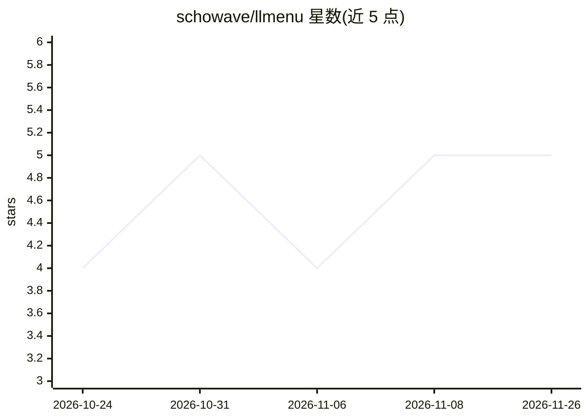

# schowave/llmenu

⭐ 5 · Go · MIT · 推送 2026-11-23 · [GitHub](https://github.com/schowave/llmenu) · [官网](https://schowave.github.io/llmenu/) · 个人维护

**团队从 LiteLLM 网关按价格/上下文/基准选模型并接入编程工具**

面向通过 LiteLLM 网关使用多模型的团队的 Go 编写的 CLI 工具：读取网关模型列表，在菜单中并排展示上下文大小、输入输出价格与基准分数并支持按质量或价格排序，选择后自动为 Claude Code、Codex CLI、Copilot CLI 等工具完成启动配置，或将模型写入 pi/opencode 配置。密钥存于 OS keyring，不改工具现有配置；支持按项目切换网关密钥、预算显示与 llmenu sync 同步。前置依赖 LiteLLM 网关（URL 与 API key），不直接连接模型提供商。

## 筛选速览

| 维度 | 判定 | 备注 |
|---|---|---|
| AI 角色 | `ai-ecosystem` | LLM/agent 周边工具 |
| 许可风险 | `permissive` | MIT |
| 部署形态 | `desktop` | 安装包/桌面程序 |
| 模型依赖 | — | README 未给出锁定关系 |
| 硬件要求 | — | 无带数字的原话,不猜 |
| 安装摩擦 | `low` | 无编译、无系统依赖或容器化 |
| 成熟度 | — | 结构信号不足 |

## 能力要点

- 菜单对比网关内模型的上下文、价格与基准分数，可排序
- 密钥存于 OS keyring（Keychain/Credential Manager/Secret Service）
- llmenu sync 将网关模型、限额与价格写入 pi/opencode 配置
- 单二进制分发，覆盖 macOS/Linux/Windows 的 amd64 与 arm64

## 适用场景

- 从网关数十个模型中为编码工具选一个合适的模型
- 按项目或成本中心切换网关密钥并查看预算消耗
- 网关模型列表变化后用一条命令同步各工具配置

## 场景标签

`模型网关` · 领域:Agent 开发

## 证据(README 行号)

> L16: **llmenu** (pronounced *L-L-menu*) is for teams that reach their models through a
> L20: way. llmenu reads the model list from the gateway, lets you compare the
> L42: - **One gateway, five tools.** Claude Code, Codex CLI and Copilot CLI are
> L47: > **Requires** a LiteLLM gateway (URL and API key). llmenu does not talk to

## 星数曲线

2026-10-24 4 → 2026-11-26 5（+1）

---
*卡片 v1 · prompt 1.4 · 生成 2026-11-21 · 置信度 high · 依据 README sha `d4c0aa2688a5` · [字段定义](../../DATASET.md)*
