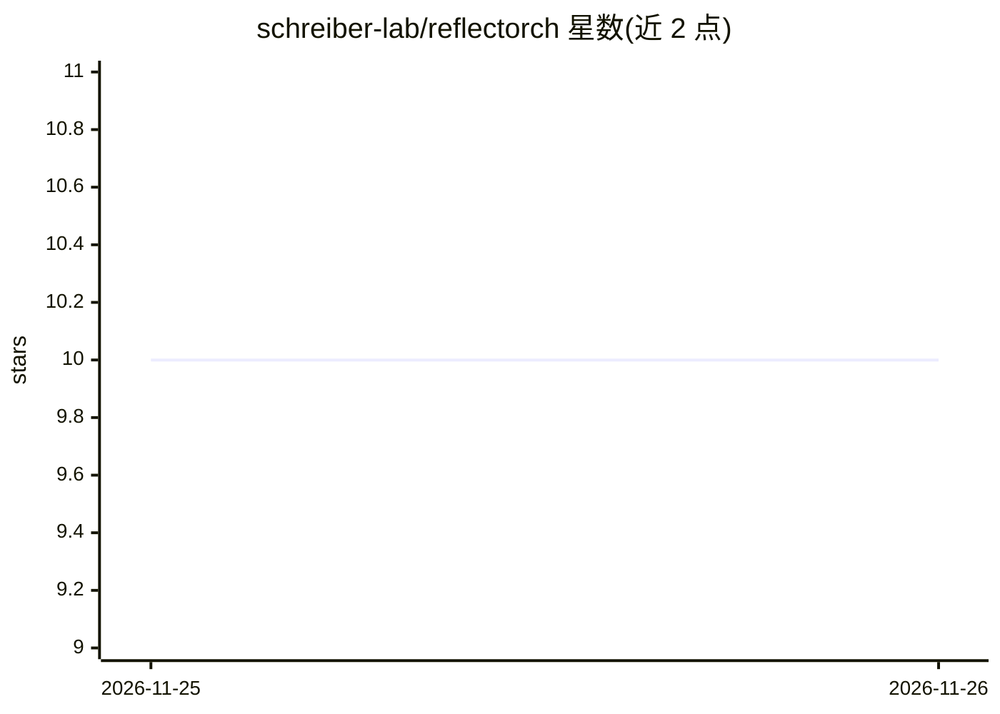

# schreiber-lab/reflectorch

⭐ 10 · Python · MIT · 推送 2026-11-12 · [GitHub](https://github.com/schreiber-lab/reflectorch) · [官网](https://www.soft-matter.uni-tuebingen.de/) · 组织维护

**为科研人员提供融合物理先验的反射率数据分析 ML 包**

Reflectorch 是图宾根大学编写的 Python 机器学习包，用于分析 X 射线与中子反射率数据。它提供 GPU 上的反射率曲线快速模拟、通过 YAML 配置文件自定义物理参数化模型与神经网络架构，以及按论文所述融入先验知识的网络训练。预训练模型（网络权重与配置文件）托管在 Hugging Face，配有 Jupyter Book/Sphinx 构建的文档和 Google Colab 交互式笔记本。Nvidia GPU 用户需按硬件与操作系统自行安装带 CUDA 支持的 PyTorch。

## 筛选速览

| 维度 | 判定 | 备注 |
|---|---|---|
| AI 角色 | `ai-native` | 本体是模型或模型工具 |
| 许可风险 | `permissive` | MIT |
| 部署形态 | `library` | 以包/库形式分发 |
| 模型依赖 | — | README 未给出锁定关系 |
| 硬件要求 | — | 无带数字的原话,不猜 |
| 安装摩擦 | `medium` | 含编译或系统依赖之一 |
| 成熟度 | — | 结构信号不足 |

## 能力要点

- GPU 上快速模拟反射率曲线
- 通过 YAML 配置文件自定义物理参数化模型与神经网络架构
- 融入先验知识的神经网络训练
- 预训练模型托管在 Hugging Face 两个仓库

## 适用场景

- 分析 X 射线与中子反射率实验数据
- 以物理参数化模型训练神经网络
- 用预训练模型在 Colab 中探索反射率数据

## 场景标签

`科研工具` · 领域:学习与行业

## 证据(README 行号)

> L17: **Reflectorch** is a machine learning Python package for the analysis of X-ray and neutron reflectometry data, writ
> L41: Users with Nvidia **GPU**s need to additionally install **Pytorch with CUDA support** corresponding to their hardwa

## 星数曲线

2026-11-25 10 → 2026-11-26 10（+0）

---
*卡片 v1 · prompt 1.4 · 生成 2026-11-24 · 置信度 high · 依据 README sha `f4ce1a69618e` · [字段定义](../../DATASET.md)*
