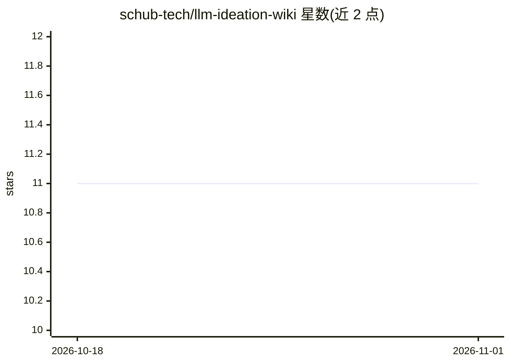

# schub-tech/llm-ideation-wiki

⭐ 11 · Python · MIT · 推送 2026-10-16 · [GitHub](https://github.com/schub-tech/llm-ideation-wiki) · [官网](https://www.schub.tech/) · 个人维护

**让 AI agent 维护 Notion 创业想法验证 wiki 的工作区**

一个基于 Notion 的创业想法整理工作区：仓库本体是 agent 运行的 harness，包含 agent 指令（AGENTS.md）、8 个技能（onboarding、new-idea、research-deep、grill-me、wiki-lint 等）、脚本与模板。用户 fork 后用 AI agent 打开该文件夹，agent 通过 Notion CLI 连接根页面并创建结构，将创业笔记、访谈与研究材料逐步推进为有证据支撑的判定。面向创业者，需自带 Claude Code 或 Codex 等 agent。

## 筛选速览

| 维度 | 判定 | 备注 |
|---|---|---|
| AI 角色 | `ai-ecosystem` | LLM/agent 周边工具 |
| 许可风险 | `permissive` | MIT |
| 部署形态 | `None` |  |
| 模型依赖 | — | README 未给出锁定关系 |
| 硬件要求 | — | 无带数字的原话,不猜 |
| 安装摩擦 | `low` | 无编译、无系统依赖或容器化 |
| 成熟度 | — | 结构信号不足 |

## 能力要点

- 8 个技能覆盖入驻、想法创建、深度研究、拷问式访谈与 wiki 质量检查
- Notion 存用户内容，本地 Markdown 供 agent 使用，仓库存 harness
- 依赖 Notion CLI，agent 可代为安装并登录
- /crisp-writing 技能以 git submodule 形式来自 ThiloReintjes/skills

## 适用场景

- 用 AI agent 把粗略的创业想法整理成结构化判定
- 记录并压力测试自己的商业想法与假设
- 让 agent 检查 wiki 中论据薄弱、证据缺失的页面

## 场景标签

`知识库管理` · 领域:知识与检索

## 证据(README 行号)

> L48: - This repo holds the harness: agent instructions, skills, scripts, templates, and local state.
> L63: Skills live in `.agents/skills/`. `CLAUDE.md` and the `.claude/skills/*` entries are compatibility symlinks for Cla

## 星数曲线

2026-10-18 11 → 2026-11-01 11（+0）

---
*卡片 v1 · prompt 1.4 · 生成 2026-11-01 · 置信度 high · 依据 README sha `e7d4856891c7` · [字段定义](../../DATASET.md)*
