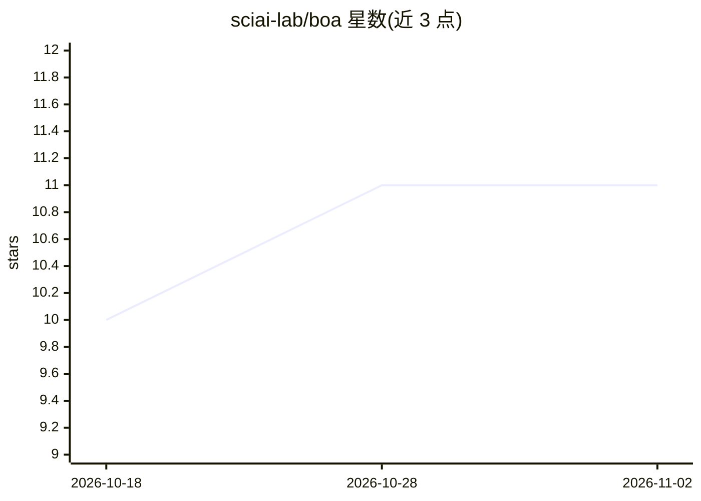

# sciai-lab/boa

⭐ 11 · Python · LGPL-3.0 · 推送 2026-08-25 · [GitHub](https://github.com/sciai-lab/boa) · 组织维护

**函数中心图神经网络预测电子密度的研究代码**

ICLR 论文 A Function-Centric Graph Neural Network Approach For Predicting Electron Densities 的官方复现代码库。基于等变图神经网络从分子结构预测电子密度，捆绑两个内部包（scdp 电荷密度预测代码与 structures25 的 mldft 包），通过 UV 管理 Python 3.11 环境安装。支持 QM9（VASP/PySCF 两种参考密度）与 MD 采样几何体三个数据集，提供训练与测试脚本，并在 Hugging Face 发布各数据集的预训练 checkpoint，可经 huggingface_hub 加载。数据路径与输出路径通过 .env 环境变量配置。

## 筛选速览

| 维度 | 判定 | 备注 |
|---|---|---|
| AI 角色 | `ai-native` | 本体是模型或模型工具 |
| 许可风险 | `viral` | LGPL-3.0 |
| 部署形态 | `library` | 以包/库形式分发 |
| 模型依赖 | — | README 未给出锁定关系 |
| 硬件要求 | — | 无带数字的原话,不猜 |
| 安装摩擦 | `low` | 无编译、无系统依赖或容器化 |
| 成熟度 | — | 结构信号不足 |

## 能力要点

- 函数中心的等变图神经网络预测电子密度
- 捆绑 scdp 与 structures25/mldft 两个上游代码包
- 支持 QM9（VASP/PySCF）与 MD 采样几何体数据集
- Hugging Face 提供各数据集预训练 checkpoint

## 适用场景

- 复现论文中电子密度预测结果
- 基于预训练 checkpoint 在 QM9/MD 数据上做密度预测
- 作为等变图神经网络在量子化学任务上的研究起点

## 场景标签

`模型训练` · 领域:训练与推理

## 证据(README 行号)

> L2: This repository contains the code to reproduce the results in the ICLR paper A Function-Centric Graph Neural Network
> L15: - **`scdp/`** — the charge density prediction codebase of

## 星数曲线

2026-10-18 10 → 2026-11-02 11（+1）

---
*卡片 v1 · prompt 1.4 · 生成 2026-11-01 · 置信度 mid · 依据 README sha `d88db7493c15` · [字段定义](../../DATASET.md)*
