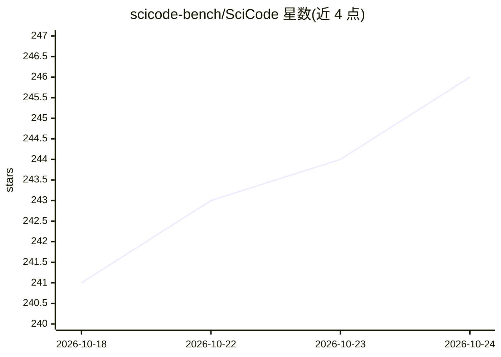

# scicode-bench/SciCode

⭐ 246 · Python · Apache-2.0 · 推送 2026-10-19 · [GitHub](https://github.com/scicode-bench/SciCode) · 组织维护

**科学家标注的科研编程基准：评测 LM 解决科学研究问题的能力**

SciCode 是评测语言模型科研编程能力的基准：80 个来自真实研究的主问题分解为 338 个子问题，覆盖物理、数学、材料、生物、化学 5 域 16 个子域，由科学家标注背景说明、标准解答与测试用例。仓库提供评测代码，推荐通过 inspect_ai 集成评估新模型（克隆仓库、pip 安装、下载测试数据、配置 API key 运行）；旧的两步评测脚本已标记为 deprecated。NeurIPS 2024 D&B Track 论文附带成果。

## 筛选速览

| 维度 | 判定 | 备注 |
|---|---|---|
| AI 角色 | `ai-ecosystem` | LLM/agent 周边工具 |
| 许可风险 | `permissive` | Apache-2.0 |
| 部署形态 | `library` | 以包/库形式分发 |
| 模型依赖 | — | README 未给出锁定关系 |
| 硬件要求 | — | 无带数字的原话,不猜 |
| 安装摩擦 | `low` | 无编译、无系统依赖或容器化 |
| 成熟度 | — | 结构信号不足 |

## 能力要点

- 80 个研究级主问题分解为 338 个子问题，含科学家标注解答与测试用例
- 覆盖 5 个自然科学领域、16 个子域
- 通过 inspect_ai 集成进行模型评测
- 数据集已上线 HuggingFace Datasets

## 适用场景

- 评测自研或商用 LLM 的科研编程能力
- 对比各模型在数值方法与仿真类任务上的表现
- 为科学 AI 助手的构建提供基准参考

## 场景标签

`模型评测` · 领域:评测与运维

## 证据(README 行号)

> L5: This repo contains the evaluation code for the paper "SciCode: A Research Coding Benchmark Curated by Scientists"
> L26: SciCode is a challenging benchmark designed to evaluate the capabilities of language models (LMs) in generating cod
> L56: ## Instructions to evaluate a new model using `inspect_ai` (recommended)

## 星数曲线

2026-10-18 241 → 2026-10-24 246（+5）

---
*卡片 v1 · prompt 1.4 · 生成 2026-10-22 · 置信度 high · 依据 README sha `c6f24aef7de4` · [字段定义](../../DATASET.md)*
