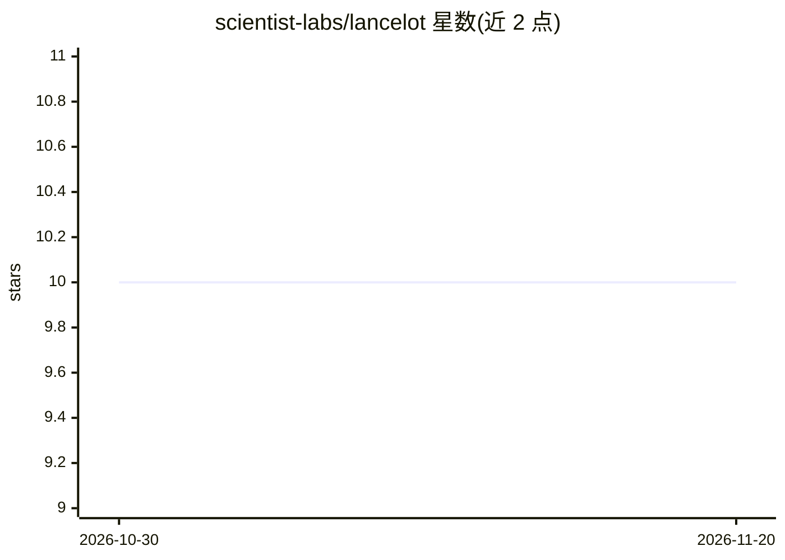

# scientist-labs/lancelot

⭐ 10 · Ruby · MIT · 推送 2026-06-30 · [GitHub](https://github.com/scientist-labs/lancelot) · 组织维护

**Ruby 语言的 Lance 列式数据格式绑定，提供向量与全文检索**

基于 Lance Rust crate 构建的 Ruby 绑定库，为 Ruby 应用提供 Lance 列式数据格式的接口，覆盖数据集创建、文档存取、向量相似度检索、基于倒排索引的全文检索，以及通过 Reciprocal Rank Fusion 融合文本与向量结果的混合检索。从源码构建 gem 需要 protoc 编译器；通过 RubyGems.org 分发的预编译 gem 无需 protoc。当前限制包括创建数据集时必须定义 schema、schema 演化暂未在绑定中暴露、字段类型限定为字符串/数值/定长向量等。

## 筛选速览

| 维度 | 判定 | 备注 |
|---|---|---|
| AI 角色 | `ai-ecosystem` | LLM/agent 周边工具 |
| 许可风险 | `permissive` | MIT |
| 部署形态 | `None` |  |
| 模型依赖 | — | README 未给出锁定关系 |
| 硬件要求 | — | 无带数字的原话,不猜 |
| 安装摩擦 | `low` | 无编译、无系统依赖或容器化 |
| 成熟度 | — | 结构信号不足 |

## 能力要点

- 向量相似度检索与倒排索引全文检索
- 通过 RRF（k 默认 60）融合向量与文本结果的混合检索
- 数据集创建、文档读写与 enumerable 支持
- 预编译 gem 无需 protoc，源码构建需 protoc

## 适用场景

- 在 Ruby 应用中存储并检索含向量与文本的多模态数据
- 为 Ruby 项目构建向量检索或全文检索能力
- 结合嵌入模型实现文本与向量的混合检索

## 场景标签

`向量数据库` · 领域:知识与检索

## 证据(README 行号)

> L3: Ruby bindings for Lance, a modern columnar data format for ML. Lancelot provides a Ruby-native interface to Lance, e
> L20: - **Vector Search**: Create vector indices and perform similarity search
> L22: - **Hybrid Search**: Combine text and vector search with Reciprocal Rank Fusion (RRF)

## 星数曲线

2026-10-30 10 → 2026-11-20 10（+0）

---
*卡片 v1 · prompt 1.4 · 生成 2026-11-19 · 置信度 high · 依据 README sha `cae9881aceeb` · [字段定义](../../DATASET.md)*
