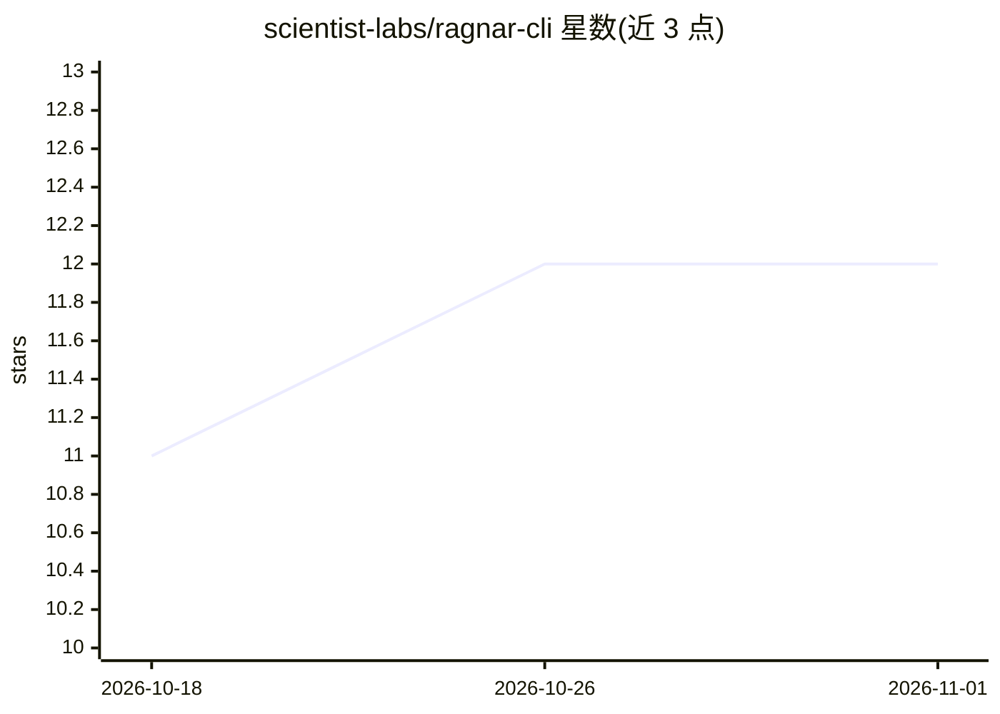

# scientist-labs/ragnar-cli

⭐ 12 · Ruby · MIT · 推送 2026-07-13 · [GitHub](https://github.com/scientist-labs/ragnar-cli) · 组织维护

**给 Ruby 开发者的命令行 RAG 工具：本地索引、语义搜索与问答**

纯 Ruby 实现的 RAG 命令行工具，提供本地文档索引、语义搜索与 LLM 问答。集成 red-candle（本地 GGUF 模型推理/嵌入/重排）、lancelot（Lance 列式向量数据库）、clusterkit（UMAP 降维聚类）与 baran（文本分块）。查询流程含查询改写、多路检索 RRF 融合、交叉编码器重排、上下文重组与答案生成。支持多 LLM 配置切换（red_candle 本地默认、anthropic、openai、ollama 等 RubyLLM 提供方），并提供 TUI 交互模式、主题建模与编程 API。主题建模需至少 20-30 篇文档。

## 筛选速览

| 维度 | 判定 | 备注 |
|---|---|---|
| AI 角色 | `ai-ecosystem` | LLM/agent 周边工具 |
| 许可风险 | `permissive` | MIT |
| 部署形态 | `None` |  |
| 模型依赖 | local-ok | 支持本地模型 |
| 硬件要求 | — | 无带数字的原话,不猜 |
| 安装摩擦 | `low` | 无编译、无系统依赖或容器化 |
| 成熟度 | — | 结构信号不足 |

## 能力要点

- 完整 Ruby RAG 流水线：分块→嵌入(768D)→向量库→重排→LLM 生成
- 查询改写、多查询检索、RRF 融合与交叉编码器重排
- 多 LLM 配置切换：red_candle 本地 GGUF、anthropic、openai、ollama
- UMAP 降维（2-50D）与主题建模（含 HTML 气泡图导出）

## 适用场景

- Ruby 开发者在本地对文档集建索引并做语义问答
- 实验与定制 agentic 工作流与 RAG 流水线
- 对已索引文档做主题建模与可视化分析

## 场景标签

`RAG` `语义搜索` · 领域:知识与检索

## 证据(README 行号)

> L3: A complete Ruby implementation of Retrieval-Augmented Generation (RAG) pipeline using native Ruby ML/NLP gems.
> L9: Ragnar provides a production-ready RAG pipeline for Ruby applications, integrating:
> L228: Ragnar supports any RubyLLM provider: `red_candle` (local), `anthropic`, `openai`, `ollama`, and more. API keys ca

## 星数曲线

2026-10-18 11 → 2026-11-01 12（+1）

---
*卡片 v1 · prompt 1.4 · 生成 2026-11-01 · 置信度 high · 依据 README sha `30fab5b60ce9` · [字段定义](../../DATASET.md)*
