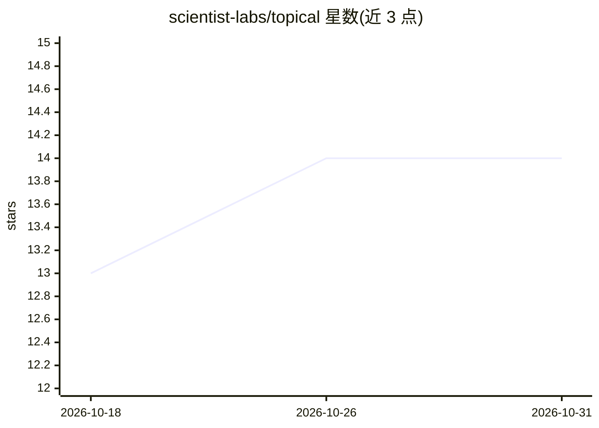

# scientist-labs/topical

⭐ 14 · Ruby · MIT · 推送 2026-06-30 · [GitHub](https://github.com/scientist-labs/topical) · 个人维护

**Ruby 主题建模库：从文档嵌入提取主题与标签**

面向 Ruby 开发者的主题建模库：读取文档嵌入向量，用 HDBSCAN（或 K-means）聚类发现主题，并以 c-TF-IDF 提取每个主题的区分性词项，由 top 2-3 词组合生成标签。支持 fit/transform 分离（新文档归入已有主题或标记为离群 -1）、对新文档单独 fit 检测主题漂移、模型保存与缓存。必需依赖 clusterkit（HDBSCAN/UMAP），可选 red-candle 用于生成嵌入及 LLM 主题摘要。gem 安装即可使用。

## 筛选速览

| 维度 | 判定 | 备注 |
|---|---|---|
| AI 角色 | `ai-native` | 本体是模型或模型工具 |
| 许可风险 | `permissive` | MIT |
| 部署形态 | `None` |  |
| 模型依赖 | — | README 未给出锁定关系 |
| 硬件要求 | — | 无带数字的原话,不猜 |
| 安装摩擦 | `low` | 无编译、无系统依赖或容器化 |
| 成熟度 | — | 结构信号不足 |

## 能力要点

- HDBSCAN 与 K-means 两种聚类方法可选
- c-TF-IDF 区分性词项提取与基于词项的主题自动标签
- fit/transform 分离，支持离群检测与主题漂移发现
- 可结合 red-candle LLM 能力生成主题摘要

## 适用场景

- 对一批文档自动发现主题并生成可读标签
- 追踪新增内容中的主题漂移与新兴主题
- 将新文档归类到已训练的主题模型

## 场景标签

 · 领域:NLP/文本分析

## 证据(README 行号)

> L3: Topic modeling for Ruby using modern clustering algorithms. Extract meaningful topics from document embeddings using
> L79: Topical uses **c-TF-IDF** (class-based TF-IDF) to find distinctive terms for each topic:

## 星数曲线

2026-10-18 13 → 2026-10-31 14（+1）

---
*卡片 v1 · prompt 1.4 · 生成 2026-10-31 · 置信度 high · 依据 README sha `a2e7c6883c79` · [字段定义](../../DATASET.md)*
