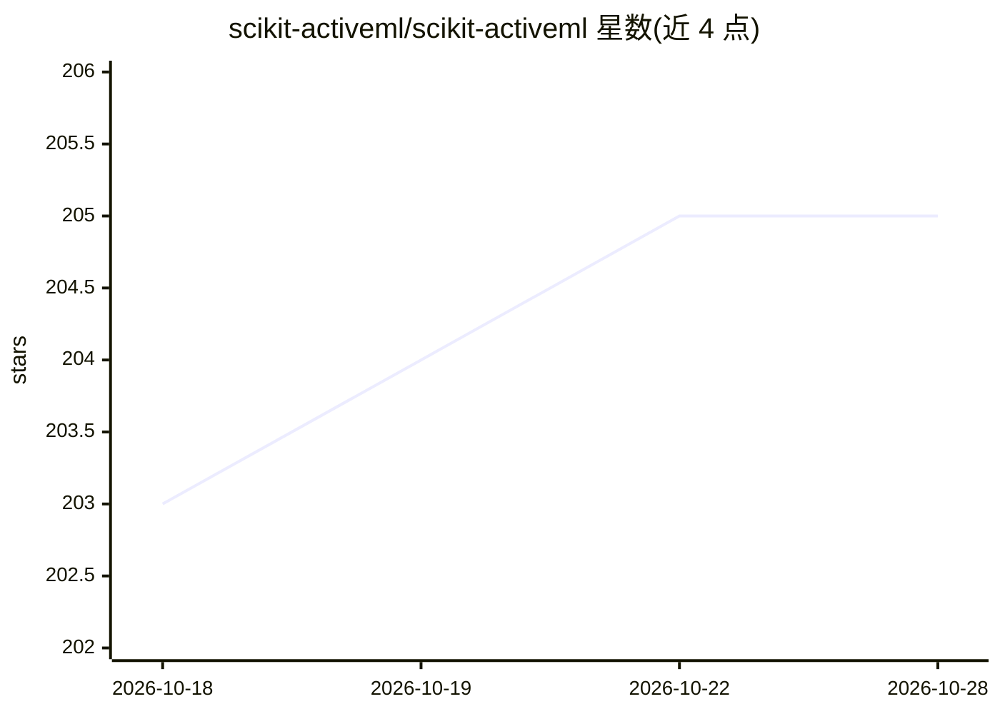

# scikit-activeml/scikit-activeml

⭐ 205 · Python · BSD-3-Clause · 推送 2026-10-27 · [GitHub](https://github.com/scikit-activeml/scikit-activeml) · [官网](https://scikit-activeml.github.io) · 组织维护

**给研究者的 Python 主动学习库：用更少标注达到高性能**

基于 scikit-learn 构建的 Python 主动学习库，面向研究场景：通过 BADGE、Split 等查询策略挑选最有信息量的样本请求标注，支持 pool-based 与 stream-based 两种循环。通过 SkorchClassifier 包装 PyTorch 模块实现深度主动学习，示例中结合 SentenceTransformer/DINOv2 嵌入与 Hugging Face datasets。torch、transformers、datasets 等不在默认安装内，需单独安装且不自动安装 PyTorch（依赖用户的 CUDA/硬件环境）。有 JMLR 论文。

## 筛选速览

| 维度 | 判定 | 备注 |
|---|---|---|
| AI 角色 | `ai-ecosystem` | LLM/agent 周边工具 |
| 许可风险 | `permissive` | BSD-3-Clause |
| 部署形态 | `library` | 以包/库形式分发 |
| 模型依赖 | — | README 未给出锁定关系 |
| 硬件要求 | — | 无带数字的原话,不猜 |
| 安装摩擦 | `medium` | 含编译或系统依赖之一 |
| 成熟度 | — | 结构信号不足 |

## 能力要点

- 基于 scikit-learn，提供 pool-based 与 stream-based 主动学习循环
- SkorchClassifier 包装 PyTorch 模块支持深度主动学习
- 提供 BADGE、Split 等多种查询策略
- pip 可安装，支持 Python 3.10-3.13

## 适用场景

- 标注预算有限时挑选最有信息量的样本进行标注
- 在文本/图像分类任务上做深度主动学习实验
- 研究与对比不同主动学习查询策略

## 场景标签

`科研工具` · 领域:学习与行业

## 证据(README 行号)

> L38: With this goal in mind, **scikit-activeml** has been developed as a Python library for active
> L39: learning on top of `scikit-learn <https://scikit-learn.org/stable/>`_. As a
> L40: result, it natively supports **deep active learning** via

## 星数曲线

2026-10-18 203 → 2026-10-28 205（+2）

---
*卡片 v1 · prompt 1.4 · 生成 2026-10-22 · 置信度 high · 依据 README sha `b9ded5040289` · [字段定义](../../DATASET.md)*
