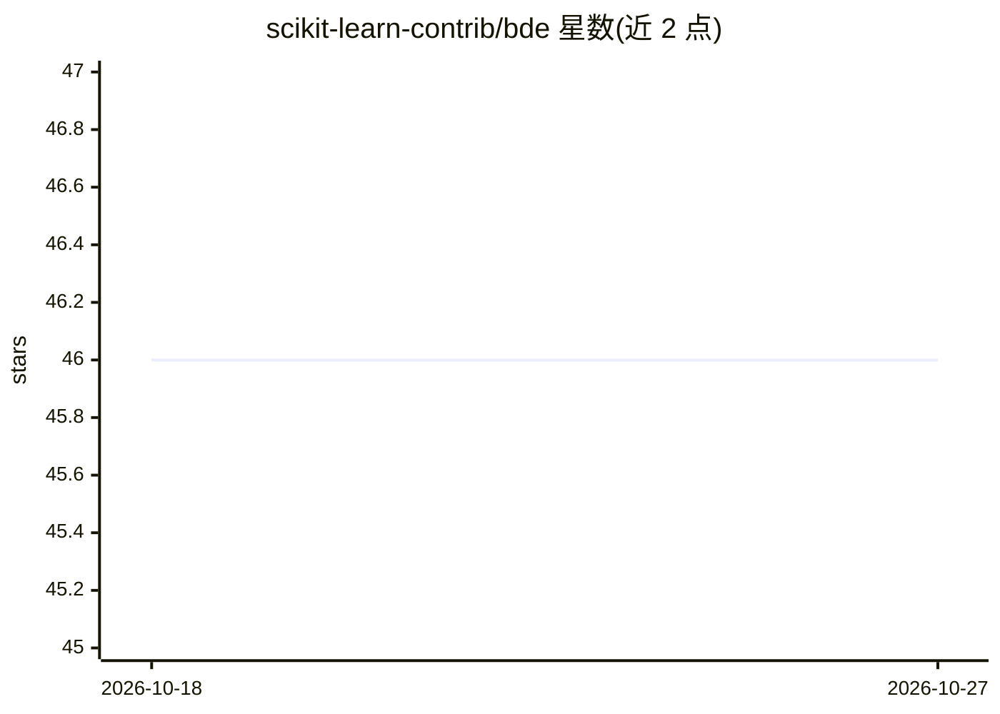

# scikit-learn-contrib/bde

⭐ 46 · Python · BSD-3-Clause · 推送 2026-08-12 · [GitHub](https://github.com/scikit-learn-contrib/bde) · [官网](https://contrib.scikit-learn.org/bde/) · 组织维护

**scikit-learn 兼容的贝叶斯深度集成库，面向表格数据不确定性量化**

bde 提供 Microcanonical Langevin Ensembles（MILE，ICLR 2025 论文方法）的实现，以 BdeRegressor/BdeClassifier 估计器接入 scikit-learn 流水线，基于 JAX 做加速器支持的训练、采样与不确定性量化。当前范围限定为全批量 MILE 与全连接前馈网络，覆盖表格数据的分类与回归；其他架构与数据模态未纳入。内置 Airfoil/Concrete/Iris 三个测试数据集，通过 PyPI 或 GitHub 安装，开发环境用 pixi 管理。

## 筛选速览

| 维度 | 判定 | 备注 |
|---|---|---|
| AI 角色 | `ai-native` | 本体是模型或模型工具 |
| 许可风险 | `permissive` | BSD-3-Clause |
| 部署形态 | `library` | 以包/库形式分发 |
| 模型依赖 | — | README 未给出锁定关系 |
| 硬件要求 | — | 无带数字的原话,不猜 |
| 安装摩擦 | `medium` | 含编译或系统依赖之一 |
| 成熟度 | — | 结构信号不足 |

## 能力要点

- BdeRegressor/BdeClassifier 可直接接入 scikit-learn 流水线
- 实现 MILE（Microcanonical Langevin Ensembles）采样方法
- 基于 JAX 支持 CPU/GPU 训练、采样与不确定性量化
- 预测输出均值、区间、概率等聚合结果

## 适用场景

- 表格数据回归/分类任务中获取预测区间与不确定性估计
- 在现有 scikit-learn 流水线中加入贝叶斯神经网络估计器
- 复现或应用 ICLR 2025 的 MILE 采样方法

## 场景标签

 · 领域:机器学习/不确定性量化

## 证据(README 行号)

> L13: **bde** is a user-friendly implementation of Bayesian Deep Ensembles compatible with
> L18: In particular, **bde** implements **Microcanonical Langevin Ensembles (MILE)** as
> L24: **Scope:** As of right now this package supports full-batch MILE for fully connected

## 星数曲线

2026-10-18 46 → 2026-10-27 46（+0）

---
*卡片 v1 · prompt 1.4 · 生成 2026-10-25 · 置信度 high · 依据 README sha `dcf2cf3457bb` · [字段定义](../../DATASET.md)*
