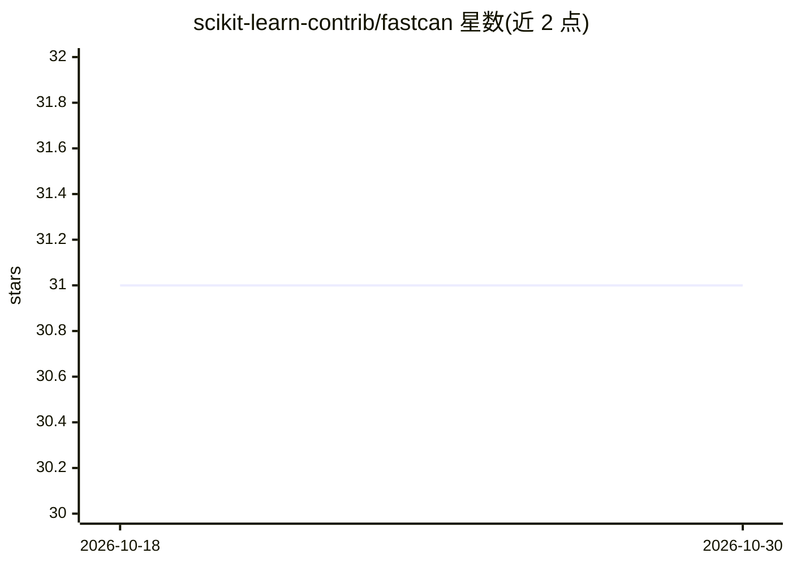

# scikit-learn-contrib/fastcan

⭐ 31 · Python · MIT · 推送 2026-10-09 · [GitHub](https://github.com/scikit-learn-contrib/fastcan) · [官网](https://fastcan.readthedocs.io/en/latest) · 组织维护

**基于典型相关性的快速特征选择与数据修剪算法库**

scikit-learn-contrib 下的 Python 搜索算法库，基于 h-correlation 与 eta-cosine 两种典型相关性方法，支持监督/无监督/多输出特征选择、NARX 时间序列模型的项选择（fastcan.narx 子模块）以及数据修剪（样本选择）。核心机制为冗余感知的逐项搜索，接口遵循 sklearn 风格（fit/get_support/scores_），支持强制包含指定特征索引。提供 pip 与 conda-forge 安装，编译有 WASM wheel 可在浏览器 Pyodide REPL 中运行，并逐步添加 Array API 兼容。附三篇论文引用条目。

## 筛选速览

| 维度 | 判定 | 备注 |
|---|---|---|
| AI 角色 | `ai-native` | 本体是模型或模型工具 |
| 许可风险 | `permissive` | MIT |
| 部署形态 | `library` | 以包/库形式分发 |
| 模型依赖 | — | README 未给出锁定关系 |
| 硬件要求 | — | 无带数字的原话,不猜 |
| 安装摩擦 | `low` | 无编译、无系统依赖或容器化 |
| 成熟度 | — | 结构信号不足 |

## 能力要点

- 监督/无监督/多输出特征选择与数据修剪（样本选择）
- fastcan.narx 子模块用于构建 NARX 时间序列模型（系统辨识）
- 冗余感知搜索与强制包含指定特征（indices_include）
- 提供 WASM wheel，可在浏览器 Pyodide REPL 中试用

## 适用场景

- 为机器学习管道做快速特征选择，处理高维或冗余特征数据
- NARX 非线性自回归模型的项选择与系统辨识
- 多输出任务（矩阵型目标）的特征筛选
- 剔除冗余样本，做数据修剪

## 场景标签

 · 领域:机器学习/数据分析

## 证据(README 行号)

> L34: fastcan is a search algorithm that supports:
> L46: #. Data pruning (i.e., sample selection)
> L102: In particular, we provide a submodule `fastcan.narx` to build Nonlinear AutoRegressive eXogenous (NARX) models.

## 星数曲线

2026-10-18 31 → 2026-10-30 31（+0）

---
*卡片 v1 · prompt 1.4 · 生成 2026-10-26 · 置信度 high · 依据 README sha `ff2e0fd5cb67` · [字段定义](../../DATASET.md)*
