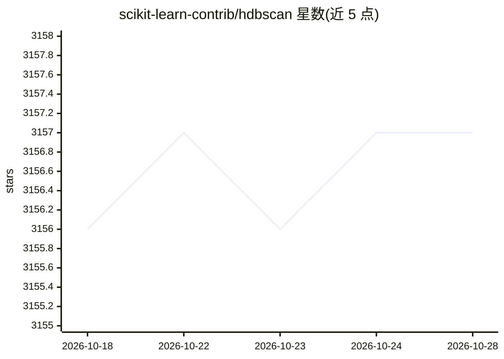

# scikit-learn-contrib/hdbscan

⭐ 3,158 · Jupyter Notebook · BSD-3-Clause · 推送 2026-10-26 · [GitHub](https://github.com/scikit-learn-contrib/hdbscan) · [官网](http://hdbscan.readthedocs.io/en/latest/) · 组织维护

**HDBSCAN 密度聚类算法的 Python 高性能实现**

scikit-learn-contrib 下的层次密度聚类库：在变化的 epsilon 值上执行 DBSCAN 并整合结果，以寻找跨尺度最稳定的聚类，可识别不同密度的簇。继承 sklearn 类，与 sklearn 聚类器调用 API 一致，支持数组、pandas dataframe、稀疏矩阵及距离矩阵输入。附加功能包括 GLOSH 离群点检测、robust single linkage 聚类、BranchDetector 分支检测、软聚类成员强度与簇持久度，以及可导出 Pandas/NetworkX 的层次可视化。经 conda-forge 与 PyPI 提供，附 JOSS 论文与教程 notebook。

## 筛选速览

| 维度 | 判定 | 备注 |
|---|---|---|
| AI 角色 | `ai-native` | 本体是模型或模型工具 |
| 许可风险 | `permissive` | BSD-3-Clause |
| 部署形态 | `library` | 以包/库形式分发 |
| 模型依赖 | — | README 未给出锁定关系 |
| 硬件要求 | — | 无带数字的原话,不猜 |
| 安装摩擦 | `low` | 无编译、无系统依赖或容器化 |
| 成熟度 | — | 结构信号不足 |

## 能力要点

- 与 sklearn 聚类器 API 一致，支持数组/稀疏矩阵/距离矩阵输入
- GLOSH 离群点检测与软聚类成员强度
- robust single linkage 与 BranchDetector 分支检测算法
- 层次结果可绘图或导出 Pandas/NetworkX

## 适用场景

- 对未知结构数据做少调参的探索性聚类分析
- 检测数据中的离群点（GLOSH 分数）
- 分析簇内分支/分形结构

## 场景标签

 · 领域:机器学习/聚类算法

## 证据(README 行号)

> L31: HDBSCAN - Hierarchical Density-Based Spatial Clustering of Applications
> L62: The hdbscan package inherits from sklearn classes, and thus drops in neatly

## 星数曲线

2026-10-18 3,156 → 2026-10-28 3,157（+1）

---
*卡片 v1 · prompt 1.4 · 生成 2026-10-20 · 置信度 high · 依据 README sha `736ade6191b8` · [字段定义](../../DATASET.md)*
