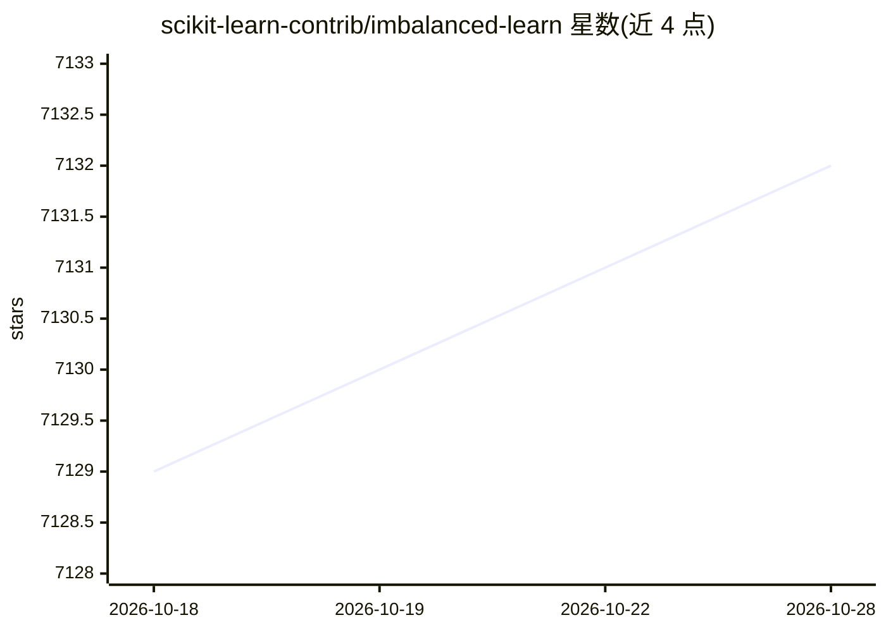

# scikit-learn-contrib/imbalanced-learn

⭐ 7,135 · Python · MIT · 推送 2026-06-29 · [GitHub](https://github.com/scikit-learn-contrib/imbalanced-learn) · [官网](https://imbalanced-learn.org) · 组织维护

**处理类别不平衡数据的 Python 重采样工具箱**

imbalanced-learn 是 scikit-learn-contrib 下的 Python 包，提供针对类别不平衡数据集的多种重采样技术（过采样/欠采样等），与 scikit-learn API 兼容。面向机器学习开发者与科研用户，用于在训练分类模型前缓解少数类样本不足的问题。依赖 Python/NumPy/SciPy/scikit-learn，可选支持 Pandas、TensorFlow、Keras 模型；通过 PyPI/conda-forge 或源码安装，2017 年发表于 JMLR 的论文可作为引用。

## 筛选速览

| 维度 | 判定 | 备注 |
|---|---|---|
| AI 角色 | `ai-native` | 本体是模型或模型工具 |
| 许可风险 | `permissive` | MIT |
| 部署形态 | `library` | 以包/库形式分发 |
| 模型依赖 | — | README 未给出锁定关系 |
| 硬件要求 | — | 无带数字的原话,不猜 |
| 安装摩擦 | `low` | 无编译、无系统依赖或容器化 |
| 成熟度 | — | 结构信号不足 |

## 能力要点

- 提供面向类别不平衡数据集的重采样技术集合
- 与 scikit-learn API 兼容，属 scikit-learn-contrib 项目
- 可选支持 Pandas 数据框与 TensorFlow/Keras 模型
- 通过 PyPI 与 conda-forge 发行，附 JMLR 论文可引用

## 适用场景

- 训练分类模型前对偏斜数据集做重采样
- 少数类样本严重不足时改善决策边界
- 在 scikit-learn 工作流中引入不平衡数据处理步骤

## 场景标签

 · 领域:机器学习/数据预处理

## 证据(README 行号)

> L43: imbalanced-learn is a python package offering a number of re-sampling techniques
> L45: It is compatible with scikit-learn_ and is part of scikit-learn-contrib_

## 星数曲线

2026-10-18 7,129 → 2026-10-28 7,132（+3）

---
*卡片 v1 · prompt 1.4 · 生成 2026-10-20 · 置信度 high · 依据 README sha `6923568172c4` · [字段定义](../../DATASET.md)*
