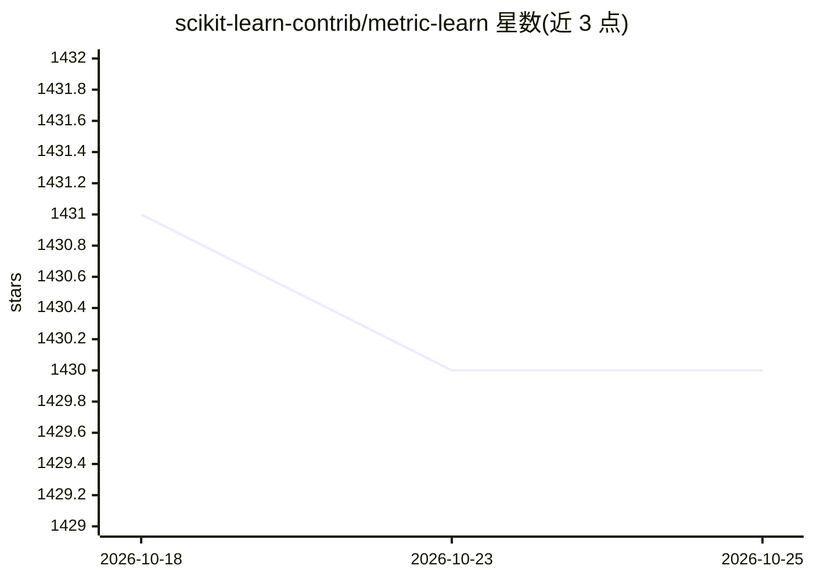

# scikit-learn-contrib/metric-learn

⭐ 1,430 · Python · MIT · 推送 2026-03-19 · [GitHub](https://github.com/scikit-learn-contrib/metric-learn) · [官网](http://contrib.scikit-learn.org/metric-learn/) · 组织维护

**Python 度量学习算法库：多种监督/弱监督度量学习实现**

scikit-learn-contrib 下的 Python 库，提供 LMNN、ITML、NCA、LFDA 等十余种监督与弱监督度量学习算法的高效实现。API 与 scikit-learn 兼容，可复用 scikit-learn 的流水线、模型选择等例程，通过统一接口调用。依赖 numpy/scipy/scikit-learn，SDML 算法可选搭配 skggm 处理问题用例。通过 PyPI、conda-forge 或源码安装，附 JMLR 论文供引用。

## 筛选速览

| 维度 | 判定 | 备注 |
|---|---|---|
| AI 角色 | `ai-native` | 本体是模型或模型工具 |
| 许可风险 | `permissive` | MIT |
| 部署形态 | `library` | 以包/库形式分发 |
| 模型依赖 | — | README 未给出锁定关系 |
| 硬件要求 | — | 无带数字的原话,不猜 |
| 安装摩擦 | `low` | 无编译、无系统依赖或容器化 |
| 成熟度 | — | 结构信号不足 |

## 能力要点

- 10 种监督/弱监督度量学习算法实现（LMNN、ITML、NCA、LFDA 等）
- API 与 scikit-learn 兼容，可复用其流水线与模型选择例程
- 支持 pip 与 conda-forge 安装，提供 sphinx 文档

## 适用场景

- 为 kNN 或聚类任务学习马氏距离度量
- 在 scikit-learn 流水线中集成度量学习算法
- 科研场景中复现度量学习方法并引用对应论文

## 场景标签

 · 领域:机器学习/算法库

## 证据(README 行号)

> L5: metric-learn contains efficient Python implementations of several popular supervised and weakly-supervised metric le
> L9: - Large Margin Nearest Neighbor (LMNN)

## 星数曲线

2026-10-18 1,431 → 2026-10-25 1,430（-1）

---
*卡片 v1 · prompt 1.4 · 生成 2026-10-21 · 置信度 high · 依据 README sha `98caeb87fc59` · [字段定义](../../DATASET.md)*
