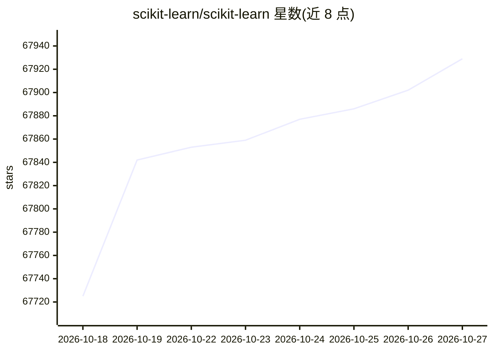

# scikit-learn/scikit-learn

⭐ 67,929 · Python · BSD-3-Clause · 推送 2026-10-26 · [GitHub](https://github.com/scikit-learn/scikit-learn) · [官网](https://scikit-learn.org) · 组织维护

**给 Python 用户提供构建于 SciPy 之上的机器学习模块**

基于 SciPy 的 Python 机器学习模块，以 3-Clause BSD 许可分发。项目 2007 年由 David Cournapeau 在 Google Summer of Code 中发起，现由志愿者社区并获多个组织支持维护。要求 Python ≥3.12 及 NumPy、SciPy、Narwhals、joblib、threadpoolctl 等依赖；绘图功能需 Matplotlib。支持 pip 或 conda-forge 安装，可用 pytest 运行测试套件，通过 git clone 获取最新源码，并附开发指南与变更日志。

## 筛选速览

| 维度 | 判定 | 备注 |
|---|---|---|
| AI 角色 | `ai-ecosystem` | LLM/agent 周边工具 |
| 许可风险 | `permissive` | BSD-3-Clause |
| 部署形态 | `library` | 以包/库形式分发 |
| 模型依赖 | — | README 未给出锁定关系 |
| 硬件要求 | — | 无带数字的原话,不猜 |
| 安装摩擦 | `low` | 无编译、无系统依赖或容器化 |
| 成熟度 | `idea` | |

## 动量与使用信号

- 维护:`active` — 距上次 push 1.6 天,年发版 3,407 位贡献者
- 涨星:近 1 天 **+5**(自 20261016 起算)
- 安装:pypi 包 `scikit-learn` 月下载 184,326,320

## 能力要点

- 基于 SciPy 的 Python 机器学习模块，BSD 3-Clause 许可
- 支持 pip 与 conda-forge 两种安装途径
- 绘图能力（plot_ 函数与 *Display 类）依赖 Matplotlib
- 提供开发指南、测试套件与 SKLEARN_SEED 随机种子控制

## 适用场景

- 在 Python 环境中安装并使用机器学习模块
- 为已有 NumPy/SciPy 工作流补充机器学习能力
- 以贡献者身份参与代码、文档与测试开发

## 场景标签

 · 领域:机器学习/数据科学工具库

## 证据(README 行号)

> L48: **scikit-learn** is a Python module for machine learning built on top of
> L56: It is currently maintained by a community of contributors, with volunteers but also `support from several
> L61: Installation

## 星数曲线

2026-10-18 67,725 → 2026-10-27 67,929（+204）

---
*卡片 v1 · prompt 1.4 · 生成 2026-10-18 · 置信度 high · 依据 README sha `1a518d0e9189` · [字段定义](../../DATASET.md)*
