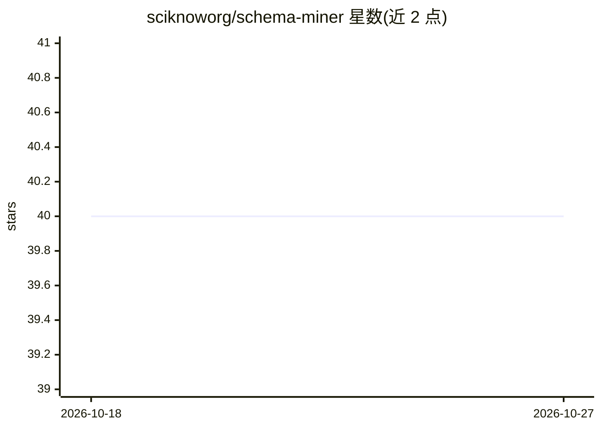

# sciknoworg/schema-miner

⭐ 40 · Jupyter Notebook · MIT · 推送 2026-08-14 · [GitHub](https://github.com/sciknoworg/schema-miner) · [官网](https://sciknoworg.github.io/schema-miner/) · 组织维护

**科研者用 LLM 三阶段人机回环挖掘科学 JSON Schema 的工具**

开源 Python 包兼 CLI，从流程规格文档与科研文献中挖掘结构化科学 Schema：Stage 1 由规格文档生成初始 JSON Schema，Stage 2/3 逐篇论文迭代精炼并支持领域专家反馈介入，另提供基于 QUDT 本体的语义 grounding（prompt 与 agentic 两种方式）。面向科研人员与领域专家；通过 .env 配置 LLM 提供方（OpenAI/SAIA/OpenRouter/Ollama/HuggingFace，亦兼容任意 OpenAI 兼容 API），结果以 JSON Schema 保存，CLI 之外附教程 notebook。限制：需配置 LLM 提供方与 API key（本地 Ollama 除外），HF 本地模式对大模型建议 CUDA GPU。

## 筛选速览

| 维度 | 判定 | 备注 |
|---|---|---|
| AI 角色 | `ai-native` | 本体是模型或模型工具 |
| 许可风险 | `permissive` | MIT |
| 部署形态 | `library` | 以包/库形式分发 |
| 模型依赖 | local-ok | 支持本地模型 |
| 硬件要求 | — | 无带数字的原话,不猜 |
| 安装摩擦 | `medium` | 含编译或系统依赖之一 |
| 成熟度 | — | 结构信号不足 |

## 能力要点

- 三阶段人机回环工作流（初始挖掘→精炼→最终验证）
- Stage 2/3 支持逐篇/分批论文迭代与专家反馈注入
- QUDT 本体 grounding（prompt 单次调用与 agentic 多步两种方法）
- 五种 LLM 提供方专属集成，兼容任意 OpenAI 兼容端点

## 适用场景

- 为科学流程从规格文档和文献中挖掘结构化数据 Schema
- 领域专家迭代审校并精炼 LLM 生成的 Schema
- 将发现的 Schema 与 QUDT 本体做语义对齐

## 场景标签

`科研工具` `文档解析` · 领域:知识与检索

## 证据(README 行号)

> L13: Schema-Miner is an open-source Python package and command-line tool for mining structured scientific schemas from p
> L129: Generates an initial JSON schema using the specified LLM config from a process specification document. Visit an ex
> L137: Schema-Miner reads the specification document, queries the LLM, and saves the resulting JSON schema to `RESULTS_PA

## 星数曲线

2026-10-18 40 → 2026-10-27 40（+0）

---
*卡片 v1 · prompt 1.4 · 生成 2026-10-25 · 置信度 high · 依据 README sha `a436accb0bf2` · [字段定义](../../DATASET.md)*
