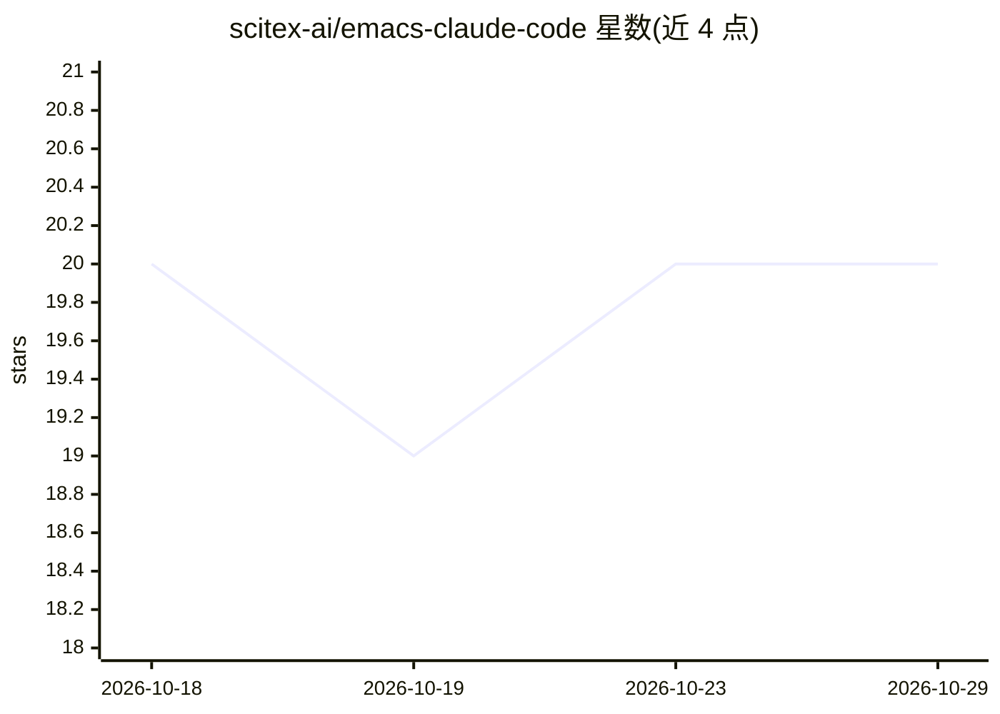

# scitex-ai/emacs-claude-code

⭐ 20 · Emacs Lisp · GPL-3.0 · 推送 2026-10-24 · [GitHub](https://github.com/scitex-ai/emacs-claude-code) · 个人维护

**Emacs 中自动化操作 Claude Code / Codex CLI 的接口层**

用 Emacs Lisp 编写的 Emacs 扩展，在 vterm 终端中对接 Claude Code（❯ 提示符）与 Codex（› 提示符）两种 CLI，自动检测权限确认等提示状态（Y/N、Y/Y/N、等待、输入建议）并按配置自动发送应答；用户正在输入时抑制所有自动应答。附带缓冲区仪表盘、音频通知、卡死看门狗与定时重发、大段内容按文件粘贴（支持远程主机）等功能，含 258 个测试。通过 git clone 到 Emacs load-path 安装。

## 筛选速览

| 维度 | 判定 | 备注 |
|---|---|---|
| AI 角色 | `ai-ecosystem` | LLM/agent 周边工具 |
| 许可风险 | `viral` | GPL-3.0 |
| 部署形态 | `None` |  |
| 模型依赖 | — | README 未给出锁定关系 |
| 硬件要求 | — | 无带数字的原话,不猜 |
| 安装摩擦 | `low` | 无编译、无系统依赖或容器化 |
| 成熟度 | — | 结构信号不足 |

## 能力要点

- 自动检测并应答 Claude Code / Codex 的 Y/N、Y/Y/N、等待等 CLI 提示状态
- 用户输入检测抑制自动应答，防止重复命令排队
- 缓冲区仪表盘：定时器状态、配置、状态时长与实时调试日志
- 卡死看门狗自动重发与定时器生命周期管理

## 适用场景

- 在 Emacs 内长时间运行 Claude Code / Codex 会话时自动处理权限确认提示
- 通过仪表盘监控多个 Claude 缓冲区的运行状态
- 将大段剪贴板内容以文件形式粘贴进 CLI，保持终端整洁

## 场景标签

`编码 Agent` · 领域:编码与开发

## 证据(README 行号)

> L3: Emacs interface for Claude Code and Codex CLI with intelligent auto-response and enhanced vterm integration.
> L9: - **Auto-Response** - Automatically responds to CLI prompts (Y/N, Y/Y/N, Waiting states) for both Claude Code and Co
> L35: |`:y/y/n`|Permission prompt with 3 options (highest priority)|Sends `"2"` + Return|

## 星数曲线

2026-10-18 20 → 2026-10-29 20（+0）

---
*卡片 v1 · prompt 1.4 · 生成 2026-10-28 · 置信度 high · 依据 README sha `e7cc0e69ec77` · [字段定义](../../DATASET.md)*
