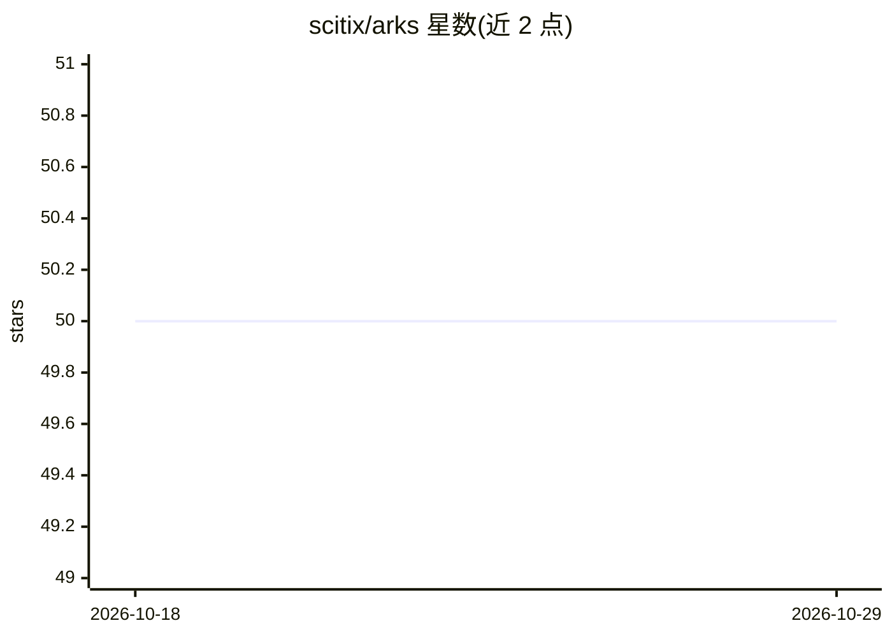

# scitix/arks

⭐ 50 · Go · Apache-2.0 · 推送 2026-05-14 · [GitHub](https://github.com/scitix/arks) · [官网](https://www.scitix.ai) · 组织维护 · 中文 README

**Kubernetes 上的 LLM 推理部署编排框架**

在 Kubernetes 集群内端到端管理 LLM 推理工作负载的云原生框架：网关层（ArksToken/ArksEndpoint）提供多租户 API Token 认证、配额与 TPM/RPM 限流及动态路由；工作负载层以 vLLM、SGLang、Dynamo 作为运行时部署为 K8s 工作负载，支持多节点调度、异构算力与 HPA 自动扩缩容；存储层（ArksModel）提供模型缓存与跨节点共享。安装依赖 Kubernetes v1.20+、LWS v0.7.0、RBGS v0.5.0-alpha.4 及 Envoy Gateway，通过 kubectl apply 安装。

## 筛选速览

| 维度 | 判定 | 备注 |
|---|---|---|
| AI 角色 | `ai-ecosystem` | LLM/agent 周边工具 |
| 许可风险 | `permissive` | Apache-2.0 |
| 部署形态 | `None` |  |
| 模型依赖 | local-ok | 支持本地模型 |
| 硬件要求 | — | 无带数字的原话,不猜 |
| 安装摩擦 | `low` | 无编译、无系统依赖或容器化 |
| 成熟度 | — | 结构信号不足 |

## 能力要点

- 支持 vLLM / SGLang / Dynamo 三种推理运行时
- 多租户 API Token、配额与 TPM/RPM 限流
- 模型缓存与跨应用/节点共享，降低冷启动
- 基于 Kubernetes HPA 的自动扩缩容与动态权重路由

## 适用场景

- 在 Kubernetes 上部署和扩缩多租户 LLM 推理服务
- 统一网关管理多个推理引擎的流量分发与配额
- 多节点分布式推理与模型缓存复用

## 场景标签

`推理引擎` `模型网关` · 领域:Agent 开发

## 证据(README 行号)

> L7: *Arks* is an end-to-end framework for managing LLM-based applications within Kubernetes clusters. It provides a robu
> L43: - Workload Layer: Each ArksApplication contains one or more runtime instances. Supported runtimes include vLLM, SGL

## 星数曲线

2026-10-18 50 → 2026-10-29 50（+0）

---
*卡片 v1 · prompt 1.4 · 生成 2026-10-25 · 置信度 high · 依据 README sha `86361cf292a5` · [字段定义](../../DATASET.md)*
