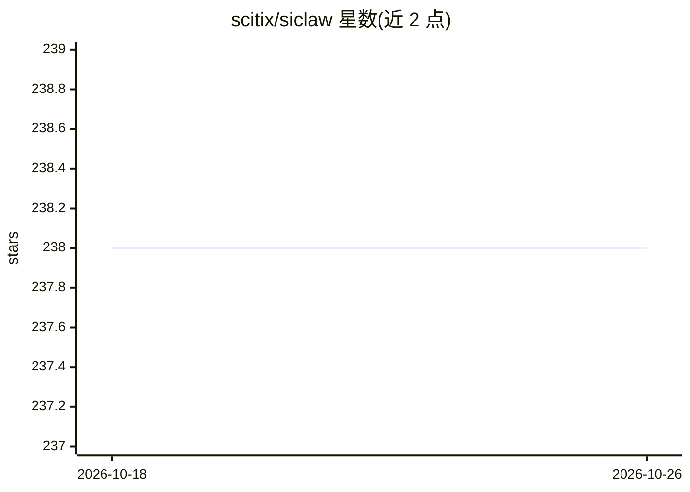

# scitix/siclaw

⭐ 238 · TypeScript · Apache-2.0 · 推送 2026-10-12 · [GitHub](https://github.com/scitix/siclaw) · [官网](https://siclaw.ai) · 组织维护

**面向 DevOps/SRE 团队的只读基础设施诊断 AI agent**

开源 AI agent 平台，用自然语言描述问题后，通过 4 阶段工作流（收集证据、形成假设、验证、输出根因分析）对基础设施做只读诊断，不直接改动环境。提供 Web Portal、聊天渠道（Slack/Lark/Discord/Telegram）与非交互 CLI 三种入口；控制面管理技能、知识库、MCP 服务器与凭据，会话在 AgentBox（K8s 每用户一个 Pod 或本地进程内）运行。本地用 npm 安装配 SQLite，团队部署用 Helm + MySQL，另支持 Langfuse/Phoenix 的 agent 追踪导出。

## 筛选速览

| 维度 | 判定 | 备注 |
|---|---|---|
| AI 角色 | `ai-native` | 本体是模型或模型工具 |
| 许可风险 | `permissive` | Apache-2.0 |
| 部署形态 | `library` | 以包/库形式分发 |
| 模型依赖 | — | README 未给出锁定关系 |
| 硬件要求 | — | 无带数字的原话,不猜 |
| 安装摩擦 | `low` | 无编译、无系统依赖或容器化 |
| 成熟度 | — | 结构信号不足 |

## 能力要点

- 4 阶段深度调查工作流与根因分析输出
- 默认只读：调查并给出建议而不改动目标环境
- 多入口访问：Web UI、聊天渠道、非交互 CLI
- 通过 MCP 连接外部工具与数据源，支持 bge-m3 嵌入的调查记忆

## 适用场景

- 用自然语言排查 K8s Pod 故障（如 CrashLoopBackOff）的根因
- 团队共享调查会话、凭据与定期巡检任务
- 把重复的诊断流程固化为可审查的技能 runbook

## 场景标签

 · 领域:运维/SRE 自动化

## 证据(README 行号)

> L16: Siclaw is an open-source AI agent for DevOps and SRE teams. It is built for **read-only infrastructure diagnostics*
> L22: - **Deep Investigation** — A 4-phase workflow for evidence gathering, hypothesis testing, and root-cause analysis

## 星数曲线

2026-10-18 238 → 2026-10-26 238（+0）

---
*卡片 v1 · prompt 1.4 · 生成 2026-10-22 · 置信度 high · 依据 README sha `abff034ed010` · [字段定义](../../DATASET.md)*
