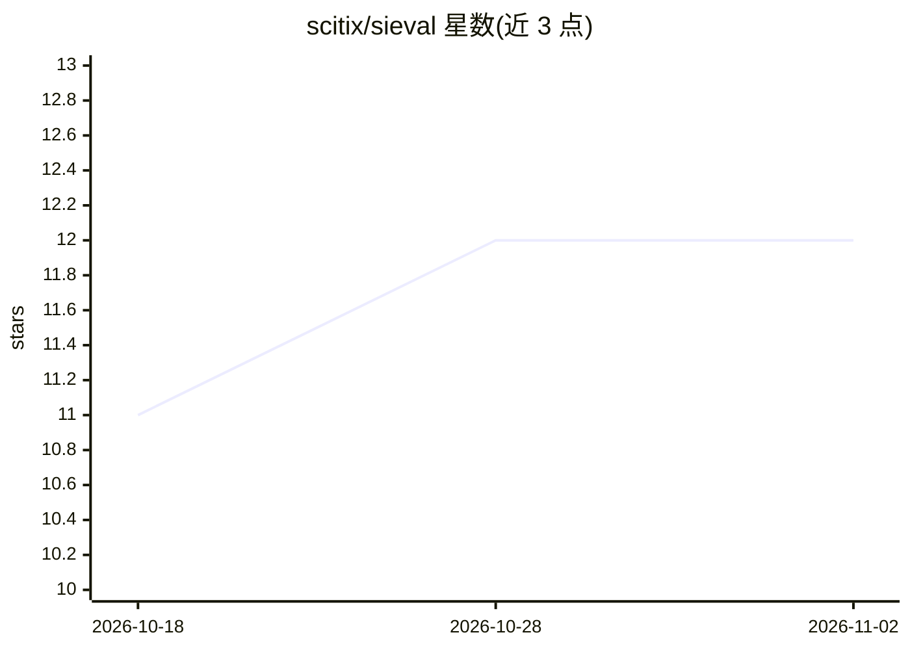

# scitix/sieval

⭐ 12 · Python · Apache-2.0 · 推送 2026-10-28 · [GitHub](https://github.com/scitix/sieval) · 组织维护

**LLM 交付质量验证系统：评测训练到推理全流程**

面向模型交付管线的异步流式评测框架，覆盖训练→转换→推理→评估各环节验证。提供六大类别基准任务（语言/知识/逻辑/数学/代码/agent），通过 `sieval run` 一站式启动推理与评测，`sieval infer` 子命令管理推理服务（自动解析、支持 vLLM/SGLang 后端）。机制上具备迭代反馈回环、分片追加式持久化以支持崩溃恢复与断点续跑、内置异常检测与性能画像（阶段耗时、I/O、token 用量）。以 Python 包（PDM/pip）从源码安装，要求 Python ≥ 3.12、Unix 系统；各基准任务有可选依赖组，通过 pip extras 安装。

## 筛选速览

| 维度 | 判定 | 备注 |
|---|---|---|
| AI 角色 | `ai-ecosystem` | LLM/agent 周边工具 |
| 许可风险 | `permissive` | Apache-2.0 |
| 部署形态 | `library` | 以包/库形式分发 |
| 模型依赖 | local-ok | 支持本地模型 |
| 硬件要求 | — | 无带数字的原话,不猜 |
| 安装摩擦 | `low` | 无编译、无系统依赖或容器化 |
| 成熟度 | — | 结构信号不足 |

## 能力要点

- 异步流式评测引擎与多轮迭代反馈回环
- 分片追加式持久化，支持崩溃恢复与按阶段断点续跑
- `sieval run/eval/infer/dataset/task` 覆盖推理编排、评测与数据管理全流程
- 内置输出质量/性能/正确性异常检测与阶段级画像（耗时、I/O、token）

## 适用场景

- SFT 后的模型在交付前跑基准套件验证质量
- 管理多个推理后端并复用在线端点做评测
- 通过采样指标（pass@k/maj@k 等）与异常检测审查交付报告

## 场景标签

`模型评测` `LLM 可观测性` · 领域:评测与运维

## 证据(README 行号)

> L3: SiEval is a **model delivery quality verification system** with an asynchronous streaming evaluation engine, iterati
> L13: - **Inference orchestration** — recipe-driven inference with auto-resolve and backend abstraction (vLLM, SGLang)

## 星数曲线

2026-10-18 11 → 2026-11-02 12（+1）

---
*卡片 v1 · prompt 1.4 · 生成 2026-11-01 · 置信度 high · 依据 README sha `0c82ce60858b` · [字段定义](../../DATASET.md)*
