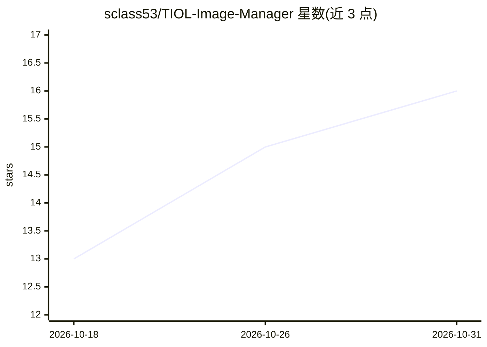

# sclass53/TIOL-Image-Manager

⭐ 16 · Rust · GPL-3.0 · 推送 2026-10-25 · [GitHub](https://github.com/sclass53/TIOL-Image-Manager) · [官网](https://tiol.netlify.app) · 个人维护 · 中文 README

**本地离线 AI 照片管理器：自动打标并按语义描述搜图**

基于 Rust/Tauri 的跨平台（Windows/macOS/Linux）桌面照片管理器，照片全部保留在本地硬盘，AI 推理完全离线运行，无需云服务。功能包括语义搜索与标签搜索双通道、冗余/模糊过曝照片一键整理、镜头与焦距过滤、RAW 格式（ARW/NEF/CRW/PEF/DNG）支持、相册与智能分组、目录监控自动处理新文件。AI 引擎可选 auto/GPU/CPU/Apple CoreML，首次启动自动下载约 412MB 模型。通过 Releases 或官网获取安装包，也可用 cargo tauri 从源码构建。

## 筛选速览

| 维度 | 判定 | 备注 |
|---|---|---|
| AI 角色 | `ai-enhanced` | 去掉 AI 部分产品仍成立 |
| 许可风险 | `viral` | GPL-3.0 |
| 部署形态 | `None` |  |
| 模型依赖 | — | README 未给出锁定关系 |
| 硬件要求 | — | 无带数字的原话,不猜 |
| 安装摩擦 | `medium` | 含编译或系统依赖之一 |
| 成熟度 | — | 结构信号不足 |

## 能力要点

- 语义搜索（自然语言描述照片内容）+ 标签搜索
- AI 推理完全本地离线运行，照片不离开本地硬盘
- 支持多种 RAW 格式（SONY ARW/NIKON NEF/CANON CRW/PEF/DNG）
- AI 引擎可选 auto/GPU/CPU/Apple CoreML，约 50MB 单文件

## 适用场景

- 在本地用一句话描述找到想要的旧照片
- 整理冗余、模糊、过曝的照片素材
- 摄影师按镜头和焦距筛选整理照片库

## 场景标签

`语义搜索` · 领域:知识与检索

## 证据(README 行号)

> L7: Your advanced, privacy-first, local-first photo manager. Automatically tags photos. Built-in fast, intelligent searc
> L17: All photos stay on your own hard drive. AI inference runs completely offline. No cloud services required.
> L23:  **Semantic search** (simply describe what you're looking for, e.g., *"a cup of coffee"*) + **Tag search** (fast)

## 星数曲线

2026-10-18 13 → 2026-10-31 16（+3）

---
*卡片 v1 · prompt 1.4 · 生成 2026-10-30 · 置信度 high · 依据 README sha `f9ea1c2a02b2` · [字段定义](../../DATASET.md)*
