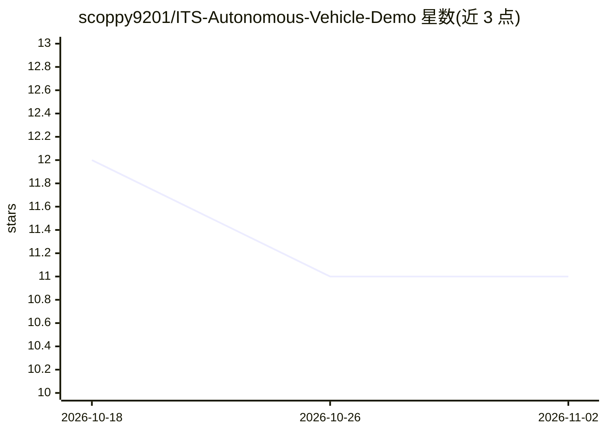

# scoppy9201/ITS-Autonomous-Vehicle-Demo

⭐ 11 · Python · 推送 2026-05-11 · [GitHub](https://github.com/scoppy9201/ITS-Autonomous-Vehicle-Demo) · 个人维护

**自动驾驶原型：车道检测、障碍识别与导航仿真实验平台**

实验性自动驾驶软件项目，面向研究与教学场景：使用 Python 与 OpenCV 实现实时车道检测、障碍物与道路元素识别、方向预测与路径计算，并模拟自主行驶行为；支持摄像头或视频输入的实时处理与传感器仿真。安装方式为 git clone 源码后 pip 安装依赖并运行 main.py。交通标志识别、深度学习检测等列为未来计划，尚未实现。

## 筛选速览

| 维度 | 判定 | 备注 |
|---|---|---|
| AI 角色 | `ai-native` | 本体是模型或模型工具 |
| 许可风险 | `none` | — |
| 部署形态 | `library` | 以包/库形式分发 |
| 模型依赖 | — | README 未给出锁定关系 |
| 硬件要求 | — | 无带数字的原话,不猜 |
| 安装摩擦 | `low` | 无编译、无系统依赖或容器化 |
| 成熟度 | — | 结构信号不足 |

## 能力要点

- OpenCV 实时车道检测与车道边界跟踪
- 障碍物与道路元素识别及环境分析
- 方向预测与路径计算的自主导航仿真
- 支持摄像头/视频输入与传感器仿真

## 适用场景

- AI 研究项目中实验自动驾驶行为
- 学习计算机视觉的车道检测与目标检测
- 学术演示或机器人课程实验

## 场景标签

`教程课程` `图像视频处理` `目标检测` · 领域:学习与行业

## 证据(README 行号)

> L18: AutoDrive Prototype is an experimental autonomous vehicle software project designed to simulate and test self-drivi
> L24: AutoDrive Prototype is a software testing platform for autonomous vehicle systems that enables real-time lane detec

## 星数曲线

2026-10-18 12 → 2026-11-02 11（-1）

---
*卡片 v1 · prompt 1.4 · 生成 2026-11-01 · 置信度 mid · 依据 README sha `54a211bb0ce0` · [字段定义](../../DATASET.md)*
