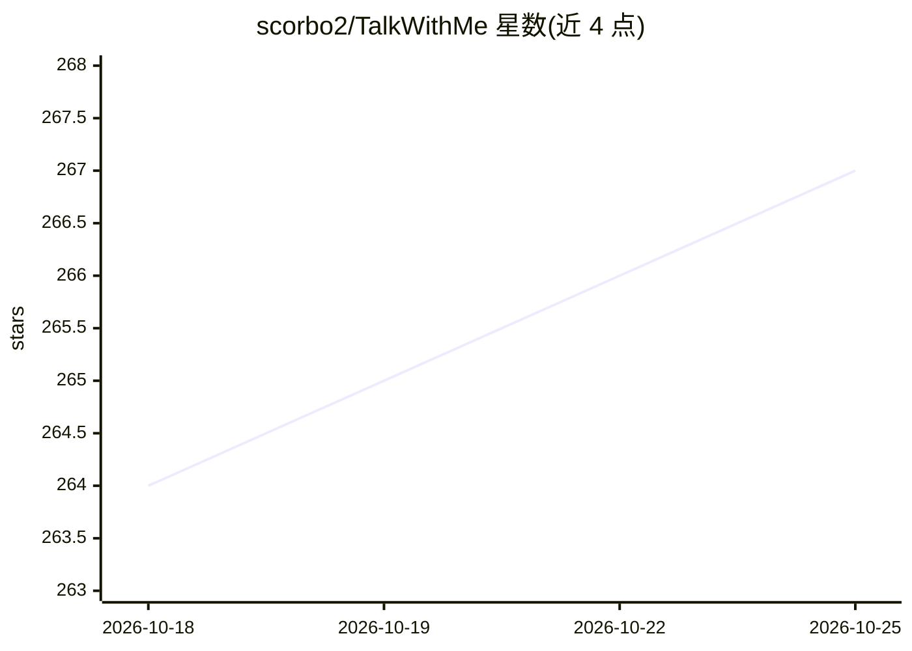

# scorbo2/TalkWithMe

⭐ 267 · Python · MIT · 推送 2026-10-16 · [GitHub](https://github.com/scorbo2/TalkWithMe) · 个人维护

**本地多人格 AI 群聊 Web 应用，带可选 TTS/STT 与 MCP 工具**

面向单用户的本地聊天 Web 应用：连接本地 llama.cpp 服务器的 OpenAI 兼容 API，支持在聊天室中配置多个 AI 人格进行模拟群聊，人格路由可由 LLM 决定、随机或手动选择。可选接入 tts-serve 做 TTS 语音播报（支持参考音频语音克隆）、OpenAI 兼容 STT 服务器做语音输入、MCP 服务器供人格调用工具。人格以目录形式持久化（prompt.md、参考音频、头像等），每个房间持久化文本与音频消息。可完全本地运行，也可配置 API key 连接远程 LLM。以 Python/FastAPI 源码形式提供，需自行运行 llama.cpp 服务器。

## 筛选速览

| 维度 | 判定 | 备注 |
|---|---|---|
| AI 角色 | `ai-native` | 本体是模型或模型工具 |
| 许可风险 | `permissive` | MIT |
| 部署形态 | `library` | 以包/库形式分发 |
| 模型依赖 | — | README 未给出锁定关系 |
| 硬件要求 | — | 无带数字的原话,不猜 |
| 安装摩擦 | `medium` | 含编译或系统依赖之一 |
| 成熟度 | — | 结构信号不足 |

## 能力要点

- 多聊天室、多 AI 人格的群聊模拟，人格路由支持 LLM 决定/随机/手动
- 可选 TTS（含参考音频语音克隆）与 OpenAI 兼容 STT 语音输入
- 可选 MCP 工具调用，按人格粒度授权
- 可 100% 本地运行，无需联网与认证，也支持配置 API key 连接远程 LLM

## 适用场景

- 搭建完全本地的多人格 AI 聊天室
- 让不同人格用克隆的音色朗读回复
- 通过麦克风语音输入提问，AI 语音回答

## 场景标签

`聊天机器人` `语音合成` · 领域:对话与助手

## 证据(README 行号)

> L3: A local single-user chat web application that connects to a locally running **llama.cpp** server and supports **mult
> L28: - Fully local — no internet required, no authentication. You can connect to remote LLMs with an API key if you wish

## 星数曲线

2026-10-18 264 → 2026-10-25 267（+3）

---
*卡片 v1 · prompt 1.4 · 生成 2026-10-22 · 置信度 high · 依据 README sha `b09692b2028c` · [字段定义](../../DATASET.md)*
