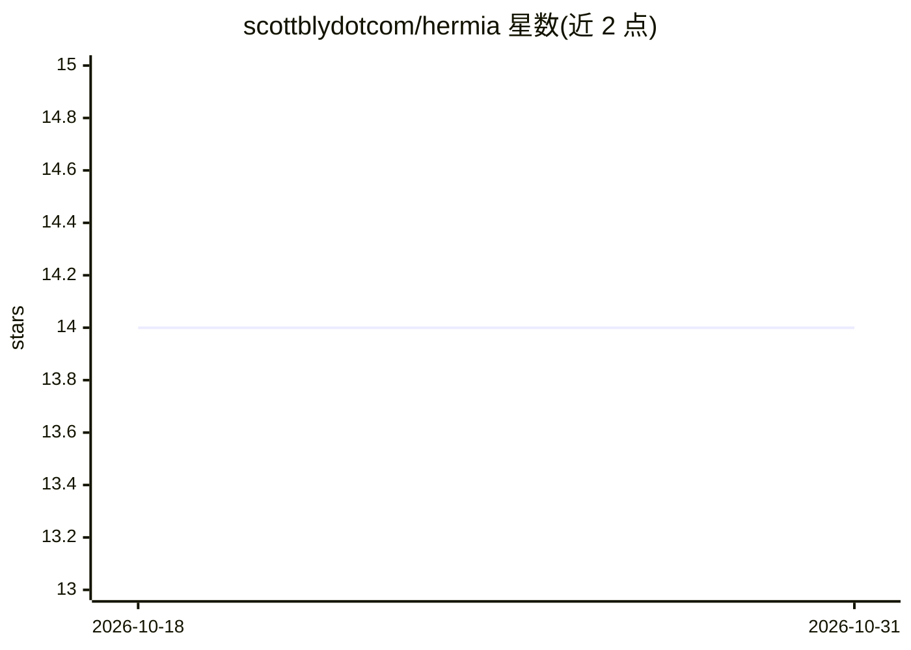

# scottblydotcom/hermia

⭐ 14 · Python · MIT · 推送 2026-10-29 · [GitHub](https://github.com/scottblydotcom/hermia) · 个人维护

**本地 LLM 推理栈的行为安全评测工具（Ollama 端点）**

面向安全从业者与本地模型运维者的行为评测 CLI/TUI 工具：对本地或 fleet 多主机的 Ollama 兼容端点运行结构化 pass/fail 评测，维度含安全（注入/凭据/越权）、工具调用、推理、约束、路由、记忆等，结果映射到 OWASP LLM Top 10、MITRE ATLAS、CSA MAESTRO、NIST AI RMF 框架；评测伴随 CPU/RAM/GPU/VRAM/tokens-persec 系统指标采集与冷加载计时。固定采样（temperature=0, seed=42）保证编排确定性；默认本地运行无需云 API key，Windows 尚不支持作为评测客户端。

## 筛选速览

| 维度 | 判定 | 备注 |
|---|---|---|
| AI 角色 | `ai-ecosystem` | LLM/agent 周边工具 |
| 许可风险 | `permissive` | MIT |
| 部署形态 | `self-host` | docker 或自建部署 |
| 模型依赖 | local-ok | 支持本地模型 |
| 硬件要求 | `cpu-ok` | |
| 安装摩擦 | `low` | 无编译、无系统依赖或容器化 |
| 成熟度 | — | 结构信号不足 |

## 能力要点

- 对 Ollama 兼容端点跑结构化行为评测，映射 OWASP/ATLAS/MAESTRO/NIST 框架
- 固定采样（temperature=0, seed=42）确定性编排与 --repeat 一致性评分
- fleet 模式从 YAML 并发评测多主机（默认 4 并行，VRAM 安全调度）
- 评测中实时采集 CPU/RAM/GPU/VRAM/tokens-per-sec 指标与冷加载基准

## 适用场景

- 模型部署前在我的硬件栈上验证安全拒绝行为是否一致
- 对比同一模型在 CUDA 与 Metal 后端的行为分歧
- 多主机推理集群的回归检测与审计报告产出

## 场景标签

`模型评测` `网络安全` · 领域:评测与运维

## 证据(README 行号)

> L20: Hermia runs structured behavioral evaluation against local Ollama models and scores results
> L30: **v0.2 scope:** structural eval with deterministic orchestration (fixed sampling —
> L36: **Fleet mode** (`--fleet FILE`) runs headless multi-host eval from a YAML config — same

## 星数曲线

2026-10-18 14 → 2026-10-31 14（+0）

---
*卡片 v1 · prompt 1.4 · 生成 2026-10-31 · 置信度 high · 依据 README sha `9ab000a68bde` · [字段定义](../../DATASET.md)*
