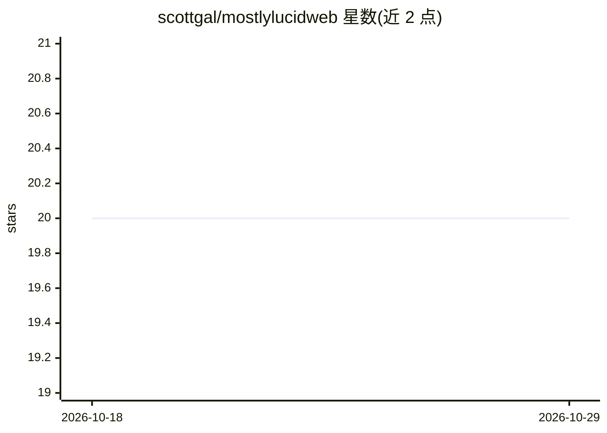

# scottgal/mostlylucidweb

⭐ 20 · C# · 推送 2026-10-27 · [GitHub](https://github.com/scottgal/mostlylucidweb) · [官网](https://www.mostlylucid.net) · 个人维护

**个人博客网站源码与 .NET/AI 工具实验仓库**

Scott Galloway 的个人网站 mostlylucid.net 的源码仓库，同时聚合其开源产出：DataSummarizer（本地 DuckDB 数据剖析 CLI，可选 LLM 叙述）、DocSummarizer（证据引用式文档摘要 CLI，支持纯 ONNX Bert 模式）、NuGet 包（MinimalBlog 博客引擎、Markdig 远程内容扩展、基于 Ollama 的 MockLlmApi、分页 TagHelper、Umami 分析客户端）、npm 包及 TinyLLM 等附加项目。站点本体为 ASP.NET Core + HTMX + PostgreSQL 博客，含 EasyNMT 十二语种翻译与 resume 网关。仓库自述为进行中的实验场。

## 筛选速览

| 维度 | 判定 | 备注 |
|---|---|---|
| AI 角色 | `ai-enhanced` | 去掉 AI 部分产品仍成立 |
| 许可风险 | `permissive` | — |
| 部署形态 | `self-host` | docker 或自建部署 |
| 模型依赖 | local-ok | 支持本地模型 |
| 硬件要求 | — | 无带数字的原话,不猜 |
| 安装摩擦 | `low` | 无编译、无系统依赖或容器化 |
| 成熟度 | `idea` | |

## 能力要点

- DataSummarizer：DuckDB 本地剖析多格式数据，可选 LLM 问答，PII 默认隐藏
- DocSummarizer：Bert 纯 ONNX 抽取摘要或 BertRag 引用式摘要，含 MCP server
- 6 个 NuGet 包：博客引擎、Markdig 扩展、Ollama mock API、Umami 客户端等
- lucidRESUME 同源网关映射独立编译器并转发反伪造 cookie

## 适用场景

- 学习 ASP.NET Core + HTMX + AI 集成的完整网站实现
- 直接使用其 CLI 工具做本地数据剖析与文档摘要
- 复用 MinimalBlog 或 Markdig FetchExtension 构建 markdown 站点

## 场景标签

`数据分析` `文档问答` · 领域:效率与自动化

## 证据(README 行号)

> L61: Turn documents or URLs into evidence-grounded summaries - every claim cites its source. Runs entirely on your machi
> L132: Lightweight ASP.NET Core middleware for generating realistic mock API responses using local LLMs (via Ollama). Add
> L249: - **Ollama** - Local LLM inference

## 星数曲线

2026-10-18 20 → 2026-10-29 20（+0）

---
*卡片 v1 · prompt 1.4 · 生成 2026-10-28 · 置信度 mid · 依据 README sha `1cc49fa05741` · [字段定义](../../DATASET.md)*
