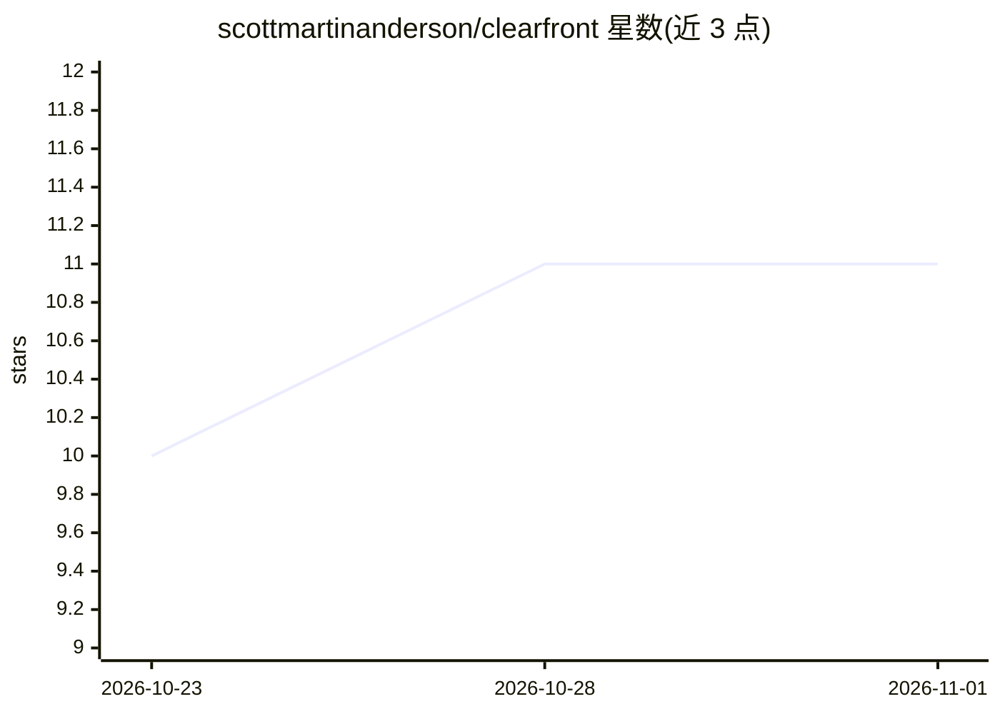

# scottmartinanderson/clearfront

⭐ 11 · Python · MIT · 推送 2026-08-26 · [GitHub](https://github.com/scottmartinanderson/clearfront) · [官网](https://clearfront.sh) · 个人维护

**开源 AI OSINT agent：扫描 3,400+ 公开数据源绘制数字足迹**

面向安全研究人员与个人用户的 OSINT AI agent：输入邮箱、用户名、域名、IP 或姓名，由 AI 分析师编排 30 个模块化工具（sherlock/maigret/holehe/Shodan/VirusTotal 等）扫描 3,400+ 公开数据源，生成校准报告与证据图。提供 REPL、CLI、本地 Web 控制台、MCP server 与 Agent Skill 五种接口。AI 后端可选 Anthropic Claude（默认）、本地 Ollama 或任意 OpenAI 兼容端点，工具结果来自真实子进程调用；本地运行、密钥自持。部分外部二进制（phoneinfoga 等）需自行安装，缺失时对应工具报错但其余可用。仅限合法授权用途。

## 筛选速览

| 维度 | 判定 | 备注 |
|---|---|---|
| AI 角色 | `ai-native` | 本体是模型或模型工具 |
| 许可风险 | `permissive` | MIT |
| 部署形态 | `self-host` | docker 或自建部署 |
| 模型依赖 | local-ok | 支持本地模型 |
| 硬件要求 | — | 无带数字的原话,不猜 |
| 安装摩擦 | `low` | 无编译、无系统依赖或容器化 |
| 成熟度 | — | 结构信号不足 |

## 能力要点

- 30 个模块化 OSINT 工具并行异步执行（asyncio.gather）
- 内置 MCP server，可向 Claude Code/Desktop 等 MCP 客户端暴露全部工具
- 三种 AI 后端：Anthropic Claude / 本地 Ollama / OpenAI 兼容端点
- REPL、CLI、Web 控制台、MCP server、Agent Skill 五种接口

## 适用场景

- 检查自己在公开数据源中的暴露面
- 对授权目标做邮箱/用户名/域名/IP 的综合调查
- 通过 MCP 或 Agent Skill 让 AI 客户端直接调用 OSINT 工具

## 场景标签

`网络安全` · 领域:学习与行业

## 证据(README 行号)

> L3:  Clearfront, also known as Clearfront OSINT, is a free and open-source OSINT agent. Give it an email, username, doma
> L25: Clearfront is an AI agent for Open Source Intelligence with five interfaces: an interactive terminal REPL, a direct

## 星数曲线

2026-10-23 10 → 2026-11-01 11（+1）

---
*卡片 v1 · prompt 1.4 · 生成 2026-11-01 · 置信度 mid · 依据 README sha `4ac1e468de8b` · [字段定义](../../DATASET.md)*
