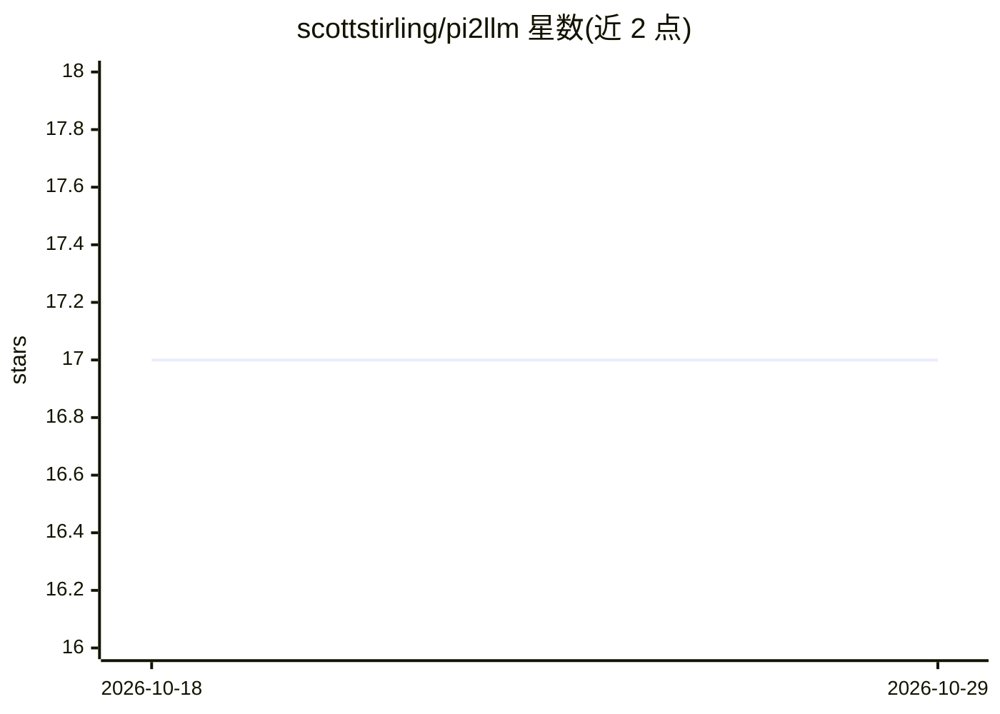

# scottstirling/pi2llm

⭐ 17 · JavaScript · MIT · 推送 2026-06-26 · [GitHub](https://github.com/scottstirling/pi2llm) · [官网](https://scottstirling.github.io/pi2llm/) · 个人维护

**在 PixInsight 内调用 LLM 的天文摄影处理助手脚本**

以 PixInsight 脚本形式接入本地或云端 LLM，读取所选图像的处理历史、天体测量数据、FITS 头等上下文，让用户在软件内对话式获取下一步处理建议、图像数据解释或成品描述。支持任何 OpenAI 兼容 API 端点（LM Studio、llama.cpp、Ollama、OpenAI、Gemini、Cloudflare AI 等），可选开启视觉分析（将图像转 JPG 以 Base64 发送，超过尺寸上限自动缩放）。配置可保存为 .pi2llm.json 档案；注意 API token 以明文存储在 JSON 文件中。安装方式为下载仓库 zip 并通过 PixInsight 的 Feature Scripts 添加。

## 筛选速览

| 维度 | 判定 | 备注 |
|---|---|---|
| AI 角色 | `ai-native` | 本体是模型或模型工具 |
| 许可风险 | `permissive` | MIT |
| 部署形态 | `desktop` | 安装包/桌面程序 |
| 模型依赖 | local-ok | 支持本地模型 |
| 硬件要求 | — | 无带数字的原话,不猜 |
| 安装摩擦 | `low` | 无编译、无系统依赖或容器化 |
| 成熟度 | — | 结构信号不足 |

## 能力要点

- 读取图像处理历史、天体测量数据、FITS 头生成上下文感知的对话
- 可选视觉分析：图像转 JPG Base64 发送，超限自动缩放（2048 像素上限）
- 可连接任何 OpenAI 兼容 API（本地 LM Studio/llama.cpp/Ollama 或云端）
- 配置档案保存/加载（.pi2llm.json），便于切换 LLM 提供商

## 适用场景

- 在 PixInsight 中询问当前图像的下一步处理建议
- 让 LLM 解读图像数据与处理历史
- 为成品天文照片生成发布用描述文字

## 场景标签

`聊天机器人` `AI 写作` · 领域:对话与助手

## 证据(README 行号)

> L5: **LLM Assistant for PixInsight** is a script that integrates a local or cloud-based Large Language Model (LLM) direc
> L39: * **Interactive Chat UI:** A modal (as required for PixInsight Scripts) dialog supporting conversation with an LLM 
> L53: 2. **An LLM Server (Local or Cloud):** You must have access to an LLM that provides an OpenAI-compatible API endpoi

## 星数曲线

2026-10-18 17 → 2026-10-29 17（+0）

---
*卡片 v1 · prompt 1.4 · 生成 2026-10-29 · 置信度 high · 依据 README sha `7c46147971b6` · [字段定义](../../DATASET.md)*
